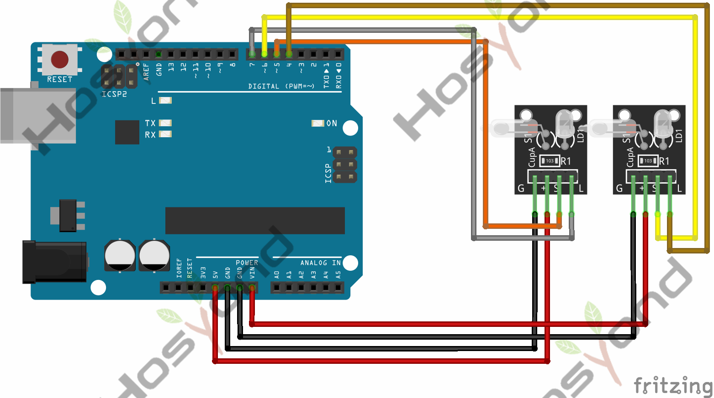
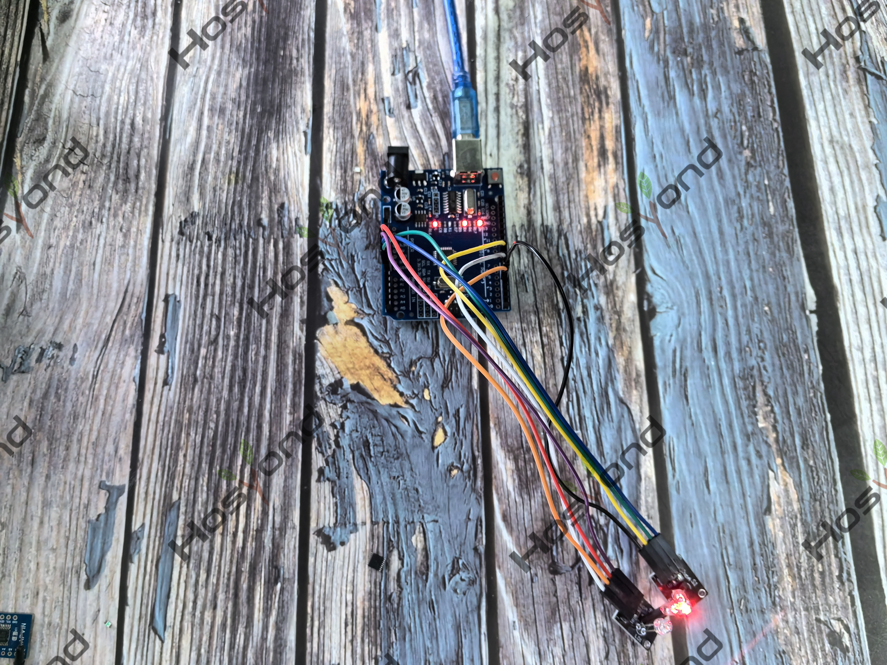

# Project 10: Magical Light Cup

## Description
Magic light cup module is able to interact with ARDUINO. The principle is based 
on PWM dimming.The mercury switch on the module can provide a digital signal and 
trigger PWM regulation. The brightness of two modules will be changed together 
through the program design, finally you can see the changing effect that two set 
of cups are pouring the light.

## Specifications
- Supply Voltage: 3.3V to 5V
- Interface: Digital

## Connection Diagram
See connection diagram image: [`img/connect/10_bb.png`](../../docs/source/img/connect/10_bb.png)

## Arduino Code
- Sketch file: [`Magic_light_cup_module.ino`](./Magic_light_cup_module.ino)

## Expected Phenomenon
See phenomenon photo: [`img/phenomenon/10.jpg`](../../docs/source/img/phenomenon/10.jpg)

## Documentation
- Sphinx source: [`docs/source/10.light_cup.rst`](../../docs/source/10.light_cup.rst)
- Offline HTML page: [`docs/build/html/10.light_cup.html`](../../docs/build/html/10.light_cup.html)
