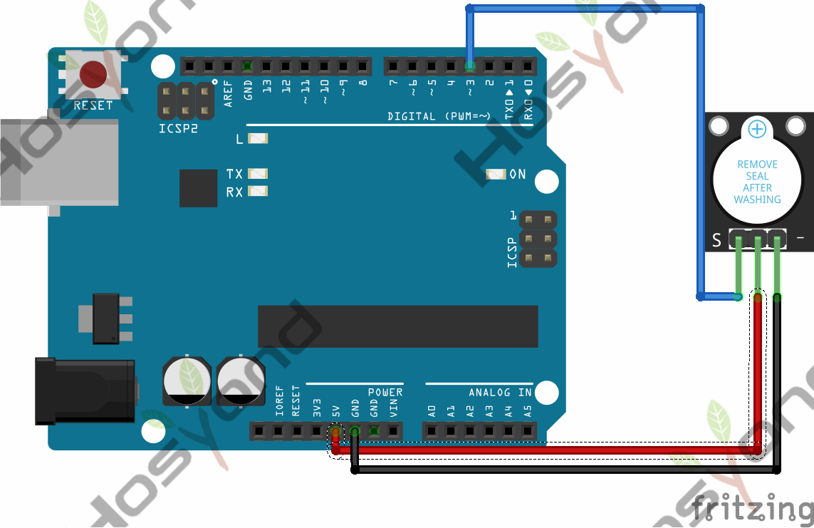
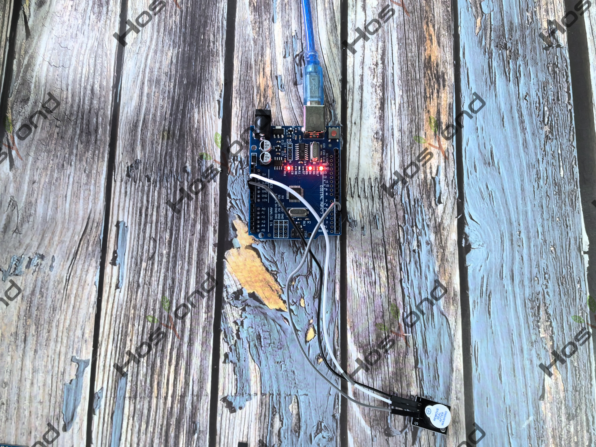

# Project 11: Active Buzzer

## Description
Here is the simplest sound making module. You can use high/low level to drive it.

## Specifications
- Working voltage: 3.3-5v
- Interface type: digital
- Size: 30*20mm
- Weight: 4g

## Connection Diagram
See connection diagram image: [`img/connect/11_bb.png`](../../docs/source/img/connect/11_bb.png)

## Arduino Code
- Sketch file: [`Active_buzzer_Module\Active_buzzer_Module.ino`](./Active_buzzer_Module/Active_buzzer_Module.ino)

## Expected Phenomenon
See phenomenon photo: [`img/phenomenon/11.jpg`](../../docs/source/img/phenomenon/11.jpg)

## Documentation
- Sphinx source: [`docs/source/11.active_buzzer.rst`](../../docs/source/11.active_buzzer.rst)
- Offline HTML page: [`docs/build/html/11.active_buzzer.html`](../../docs/build/html/11.active_buzzer.html)
