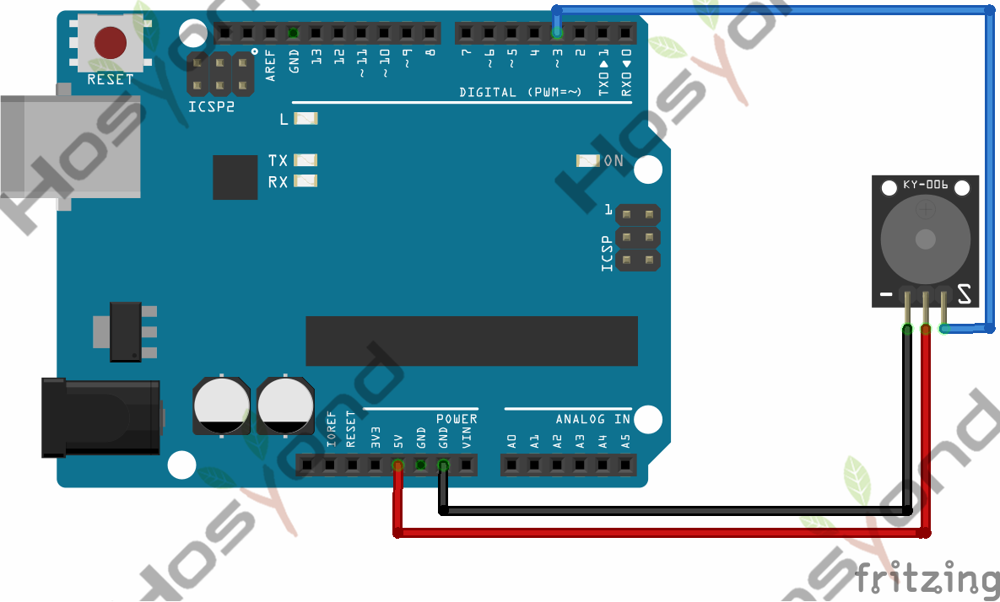
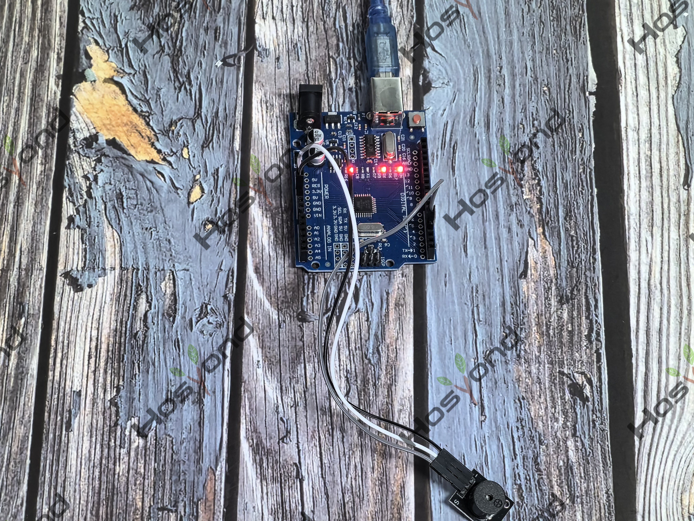

# Project 12: Passtive Buzzer

## Description
We can use Arduino to make many interactive works of which the most commonly used 
is acoustic-optic display. The circuit in this experiment can produce sound.

## Specifications
- Working voltage: 3.3-5v
- Interface type: digital
- Size: 30*20mm
- Weight: 4g

## Connection Diagram
See connection diagram image: [`img/connect/12_bb.png`](../../docs/source/img/connect/12_bb.png)

## Arduino Code
- Sketch file: [`Passtive_Buzzer\Passtive_Buzzer.ino`](./Passtive_Buzzer/Passtive_Buzzer.ino)

## Expected Phenomenon
See phenomenon photo: [`img/phenomenon/12.jpg`](../../docs/source/img/phenomenon/12.jpg)

## Documentation
- Sphinx source: [`docs/source/12.passtive_buzzer.rst`](../../docs/source/12.passtive_buzzer.rst)
- Offline HTML page: [`docs/build/html/12.passtive_buzzer.html`](../../docs/build/html/12.passtive_buzzer.html)
