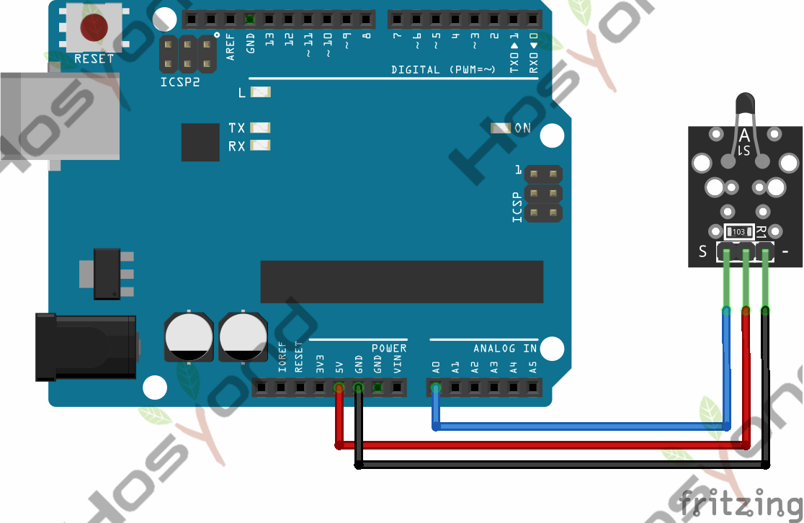
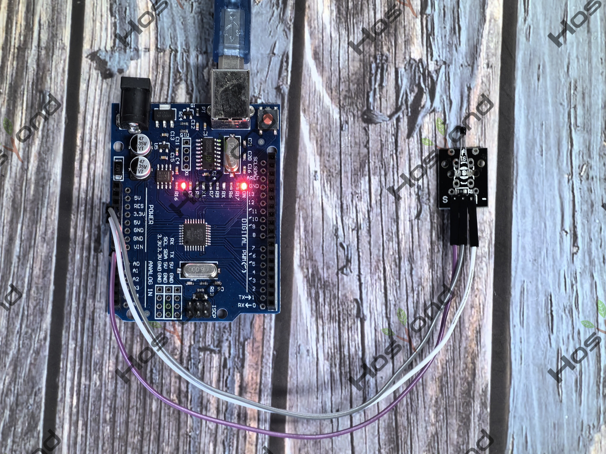

# Project 13: Analog Temperature

## Description
This module is based on the working principle of a thermistor (resistance varies 
with temperature change in the environment).It can sense temperature changes in 
the surrounding and send the data to the analog IO of Arduino board. All we need 
to do is to convert the sensor’s output data into degrees Celsius temperature via 
simple programming, finally displaying it on the monitor.

## Specifications
- Interface type: analog
- Working voltage: 5V
- Temperature range: -55℃～315℃
- Size: 30*20mm
- Weight: 3g

## Connection Diagram
See connection diagram image: [`img/connect/13_bb.png`](../../docs/source/img/connect/13_bb.png)

## Arduino Code
- Sketch file: [`temp\temp.ino`](./temp/temp.ino)

## Expected Phenomenon
See phenomenon photo: [`img/phenomenon/13.jpg`](../../docs/source/img/phenomenon/13.jpg)

## Documentation
- Sphinx source: [`docs/source/13.analog_temperature.rst`](../../docs/source/13.analog_temperature.rst)
- Offline HTML page: [`docs/build/html/13.analog_temperature.html`](../../docs/build/html/13.analog_temperature.html)
