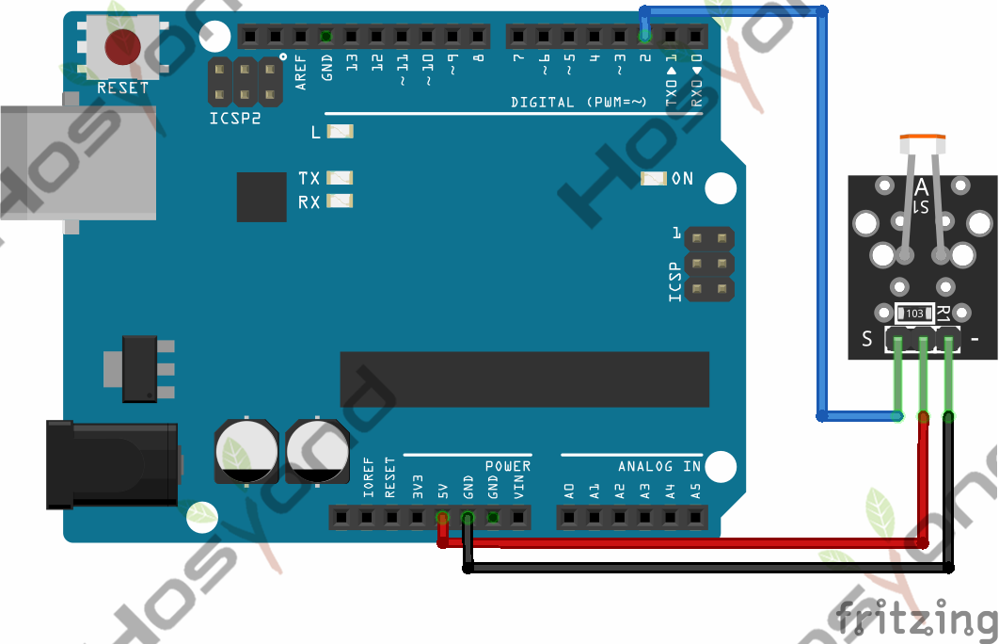
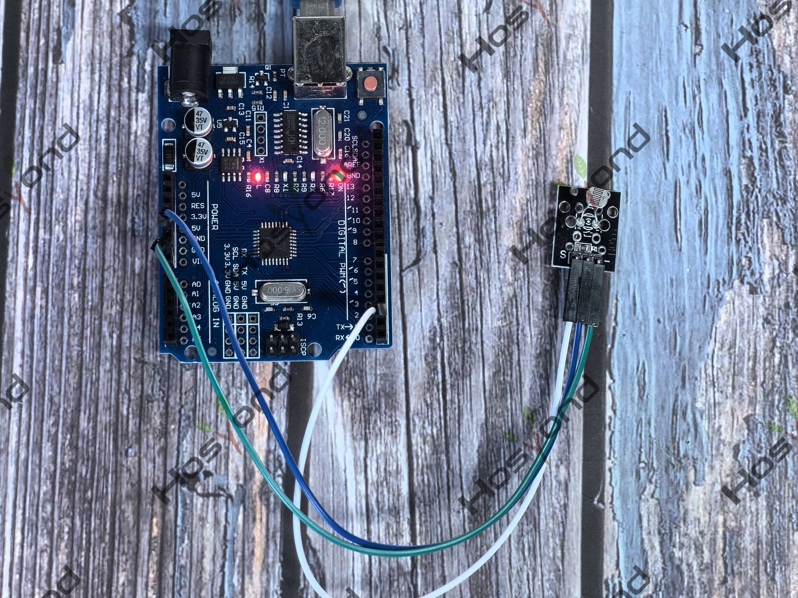

# Project 14: Photoresistor Module

## Description
Photocell is commonly seen in our daily life and is mainly used in intelligent 
switch, also in common electronic design. To make it easier and more effective, 
we supply the corresponding modules.

## Connection Diagram
See connection diagram image: [`img/connect/14_bb.png`](../../docs/source/img/connect/14_bb.png)

## Arduino Code
- Sketch file: [`Photoresistor_Module\Photoresistor_Module.ino`](./Photoresistor_Module/Photoresistor_Module.ino)

## Expected Phenomenon
See phenomenon photo: [`img/phenomenon/14.jpg`](../../docs/source/img/phenomenon/14.jpg)

## Documentation
- Sphinx source: [`docs/source/14.photoresistor_module.rst`](../../docs/source/14.photoresistor_module.rst)
- Offline HTML page: [`docs/build/html/14.photoresistor_module.html`](../../docs/build/html/14.photoresistor_module.html)
