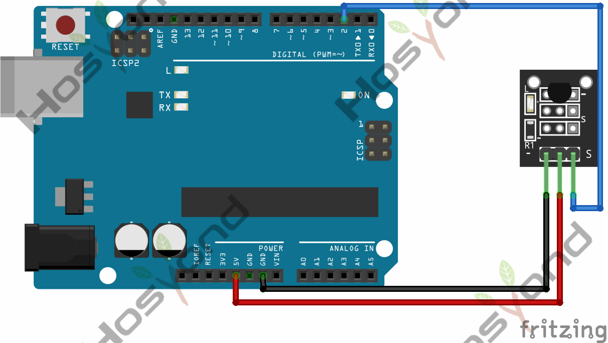
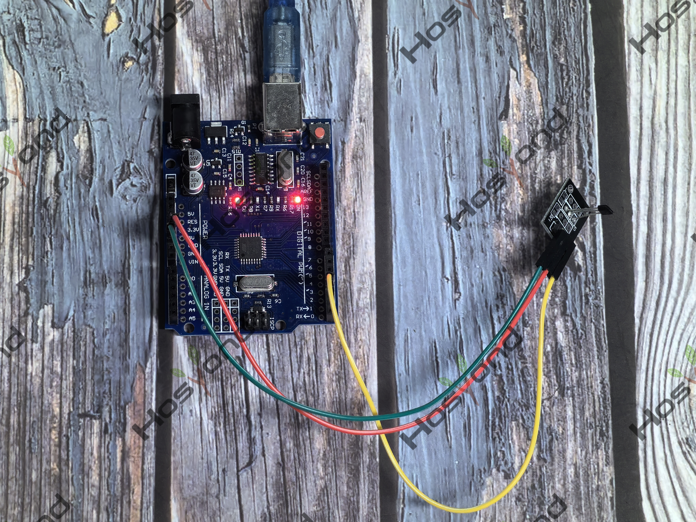

# Project 15: DS18B20_sensor

## Description
The DS18B20 temperature sensor is a one-wire digital temperature sensor. This means 
that it just requires one data line (and GND) to communicate with the Arduino.

## Specifications
- -55°C to +85°C temperature measurement range with good accurac
- 1-wire interface to save on MCU pins
- LED to indicate module communications
- 3.3 and 5V compatible

## Connection Diagram
See connection diagram image: [`img/connect/15_bb.png`](../../docs/source/img/connect/15_bb.png)

## Arduino Code
- Sketch file: [`DS18B20_sensor_module_1\DS18B20_sensor_module_1.ino`](./DS18B20_sensor_module_1/DS18B20_sensor_module_1.ino)

## Expected Phenomenon
See phenomenon photo: [`img/phenomenon/15.jpg`](../../docs/source/img/phenomenon/15.jpg)

## Documentation
- Sphinx source: [`docs/source/15.ds18b20_sensor.rst`](../../docs/source/15.ds18b20_sensor.rst)
- Offline HTML page: [`docs/build/html/15.ds18b20_sensor.html`](../../docs/build/html/15.ds18b20_sensor.html)
