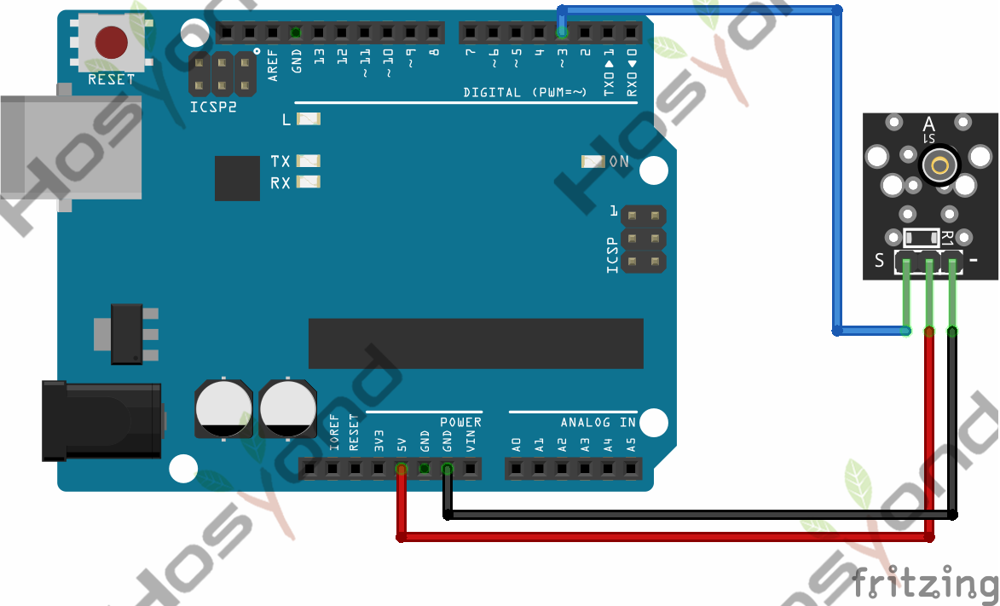
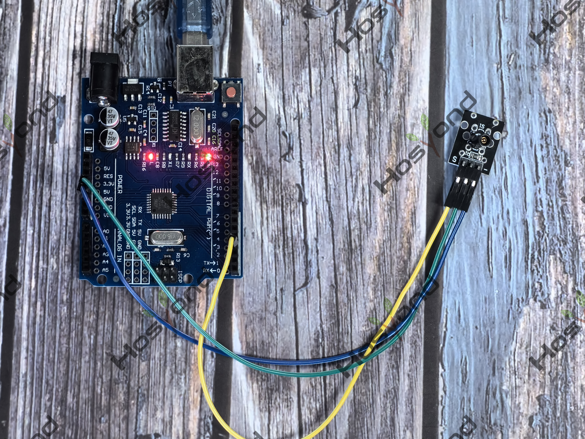

# Project 16: Shock Sensor

## Description
The KY-002 Vibration Switch Module detects shaking and knocking. When the module 
is moved, a spring mechanism will close the circuit sending a short high signal.

## Specifications
- Operating Voltage	5V
- Board Dimensions	18.5mm x 15mm [0.728in x 0.591in]

## Connection Diagram
See connection diagram image: [`img/connect/16_bb.png`](../../docs/source/img/connect/16_bb.png)

## Arduino Code
- Sketch file: [`shock\shock.ino`](./shock/shock.ino)

## Expected Phenomenon
See phenomenon photo: [`img/phenomenon/16.jpg`](../../docs/source/img/phenomenon/16.jpg)

## Documentation
- Sphinx source: [`docs/source/16.shock_sensor.rst`](../../docs/source/16.shock_sensor.rst)
- Offline HTML page: [`docs/build/html/16.shock_sensor.html`](../../docs/build/html/16.shock_sensor.html)
