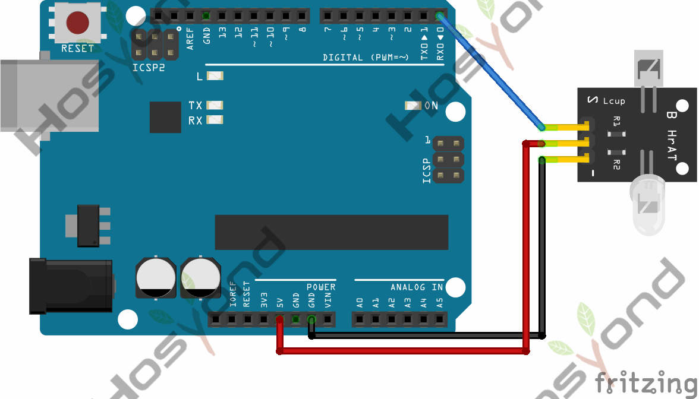
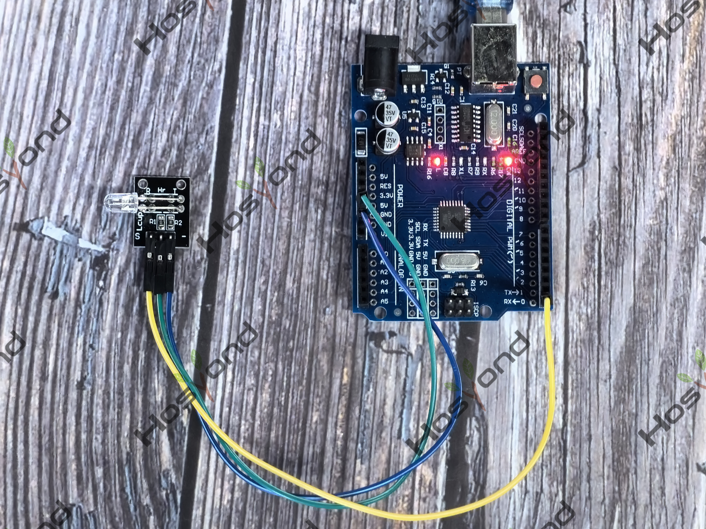

# Project 17: Pulse Rate Monitor

## Description
This module makes use of a ultra-clear infrared LED and a phototransistor to 
detect the pulse in your finger. The red LED will flash in time with your pulse.

## Specifications
Connect
--------
.. image:: /img/connect/17_bb.png

## Connection Diagram
See connection diagram image: [`img/connect/17_bb.png`](../../docs/source/img/connect/17_bb.png)

## Arduino Code
- Sketch file: [`17.Pulse_Rate_Monitor.ino`](./17.Pulse_Rate_Monitor.ino)

## Expected Phenomenon
See phenomenon photo: [`img/phenomenon/17.jpg`](../../docs/source/img/phenomenon/17.jpg)

## Documentation
- Sphinx source: [`docs/source/17.pulse_rate_monitor.rst`](../../docs/source/17.pulse_rate_monitor.rst)
- Offline HTML page: [`docs/build/html/17.pulse_rate_monitor.html`](../../docs/build/html/17.pulse_rate_monitor.html)
