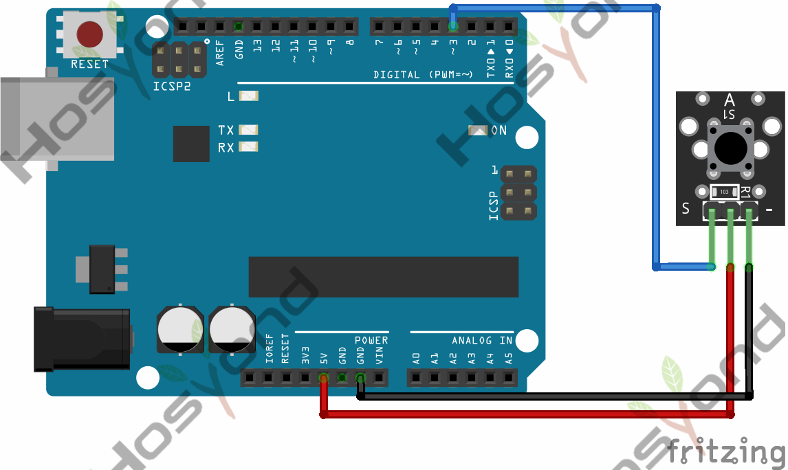
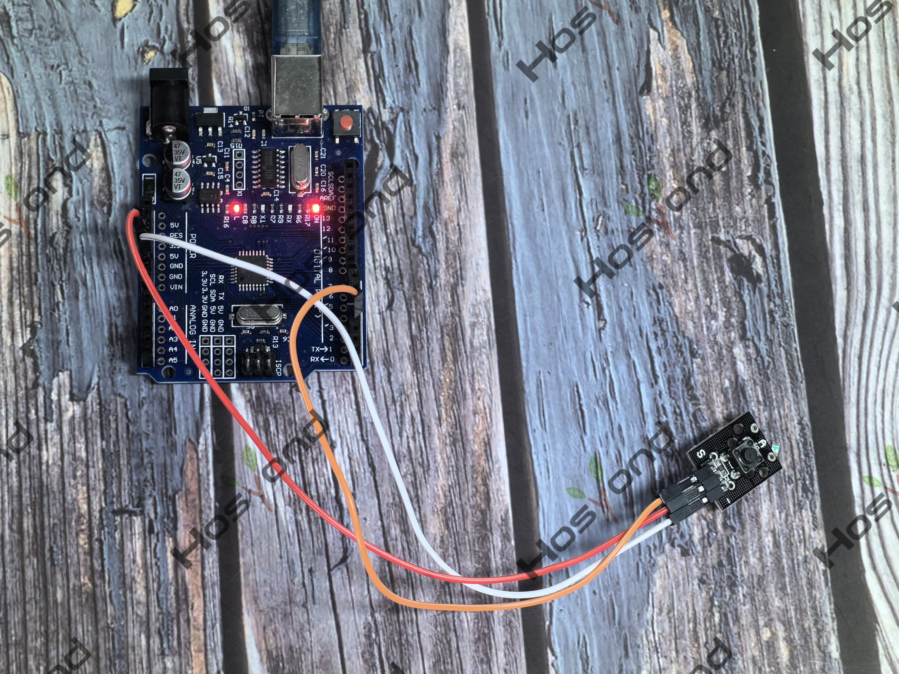

# Project 18: Button

## Description
This is a basic button module. You can simply plug it into an IO shield to have 
your first try of Arduino.

## Specifications
- Supply Voltage: 3.3V to 5V
- Interface: Digital
- Dimensions: 30*20mm
- Weight: 4g

## Connection Diagram
See connection diagram image: [`img/connect/18_bb.png`](../../docs/source/img/connect/18_bb.png)

## Arduino Code
- Sketch file: [`18.Button.ino`](./18.Button.ino)

## Expected Phenomenon
See phenomenon photo: [`img/phenomenon/18.jpg`](../../docs/source/img/phenomenon/18.jpg)

## Documentation
- Sphinx source: [`docs/source/18.button.rst`](../../docs/source/18.button.rst)
- Offline HTML page: [`docs/build/html/18.button.html`](../../docs/build/html/18.button.html)
