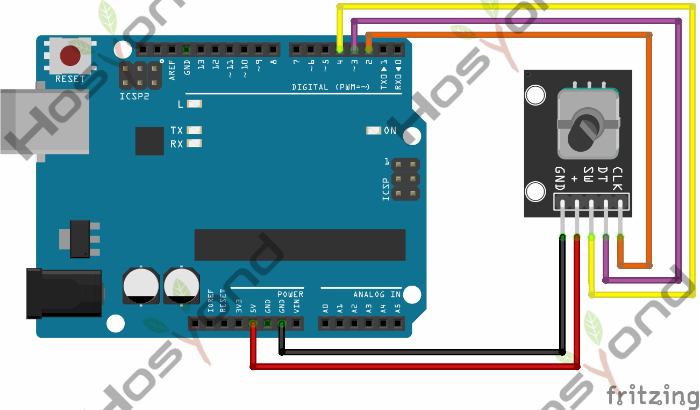
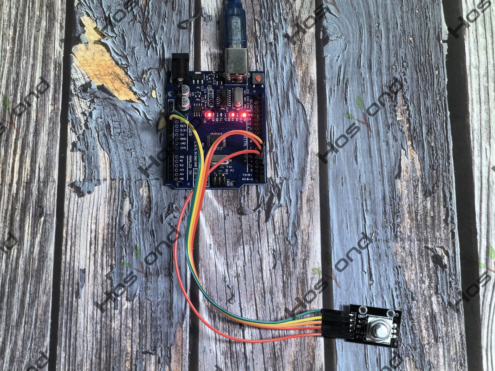

# Project 19: Rotary Encoder

## Description
The rotary encoder can count the pulse outputting times during the process of 
rotation in positive and reverse direction.

## Specifications
- Power Supply: 5V
- Interface: Digital
- Size: 30*20mm
- Weight: 7g

## Connection Diagram
See connection diagram image: [`img/connect/19_bb.png`](../../docs/source/img/connect/19_bb.png)

## Arduino Code
- Sketch file: [`19.Rotary_Encoder.ino`](./19.Rotary_Encoder.ino)

## Expected Phenomenon
See phenomenon photo: [`img/phenomenon/19.jpg`](../../docs/source/img/phenomenon/19.jpg)

## Documentation
- Sphinx source: [`docs/source/19.rotary_encoder.rst`](../../docs/source/19.rotary_encoder.rst)
- Offline HTML page: [`docs/build/html/19.rotary_encoder.html`](../../docs/build/html/19.rotary_encoder.html)
