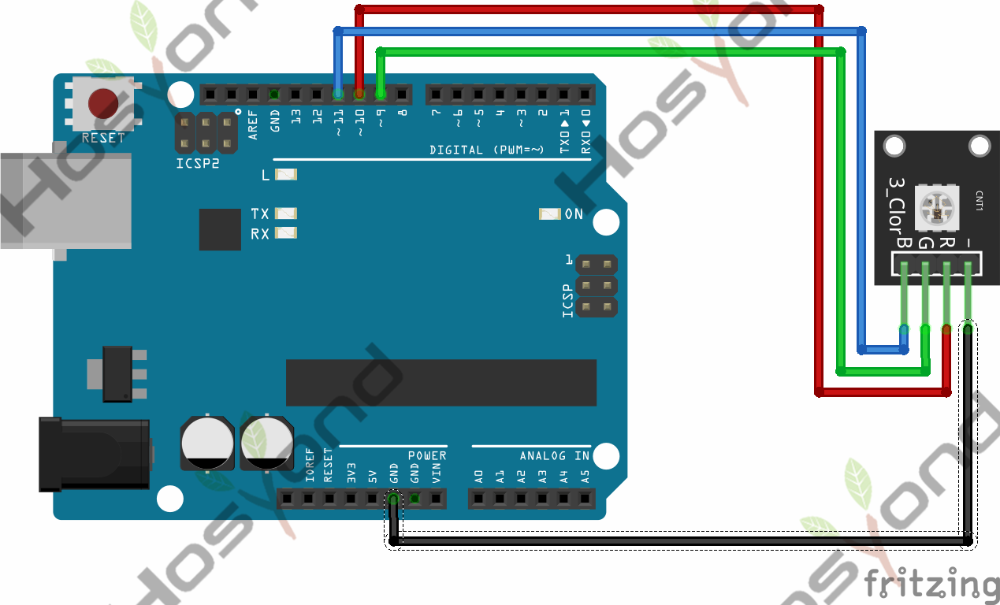
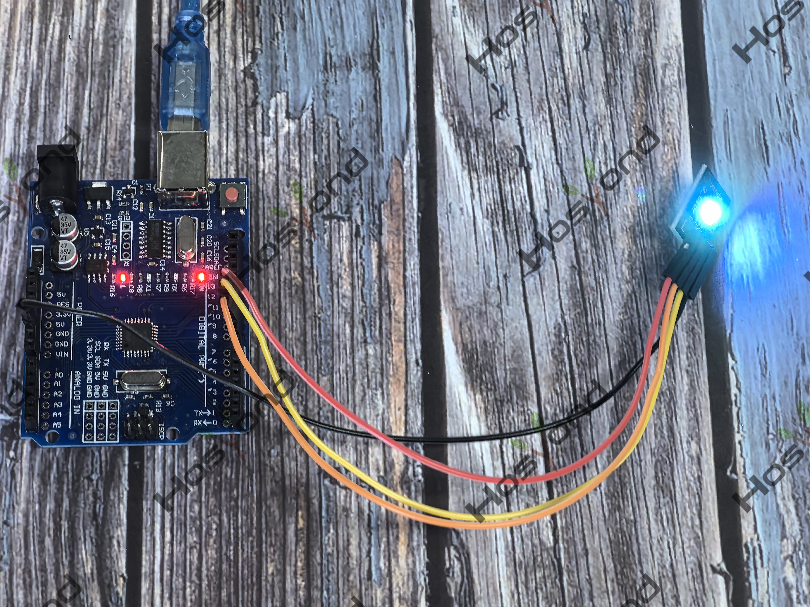

# Project 2: SMD RGB

## Description
This is a full-color LED module, which contains 3 basic colors－red, green and blue. They can be seen as separate LED lights. After programming, you can turn them on and off by sequence or can also use PWM analog output to mix three colors to generate different colors.

## Specifications
- Color: Red, Green, and Blue
- Brightness: High
- Voltage: 5V
- Input: Digital Level
- Size: 30*20mm
- Weight: 3g

## Connection Diagram
See connection diagram image: [`img/connect/2_bb.png`](../../docs/source/img/connect/2_bb.png)

## Arduino Code
- Sketch file: [`2.Smd_Rgb.ino`](./2.Smd_Rgb.ino)

## Expected Phenomenon
See phenomenon photo: [`img/phenomenon/2.jpg`](../../docs/source/img/phenomenon/2.jpg)

## Documentation
- Sphinx source: [`docs/source/2.smd_rgb.rst`](../../docs/source/2.smd_rgb.rst)
- Offline HTML page: [`docs/build/html/2.smd_rgb.html`](../../docs/build/html/2.smd_rgb.html)
