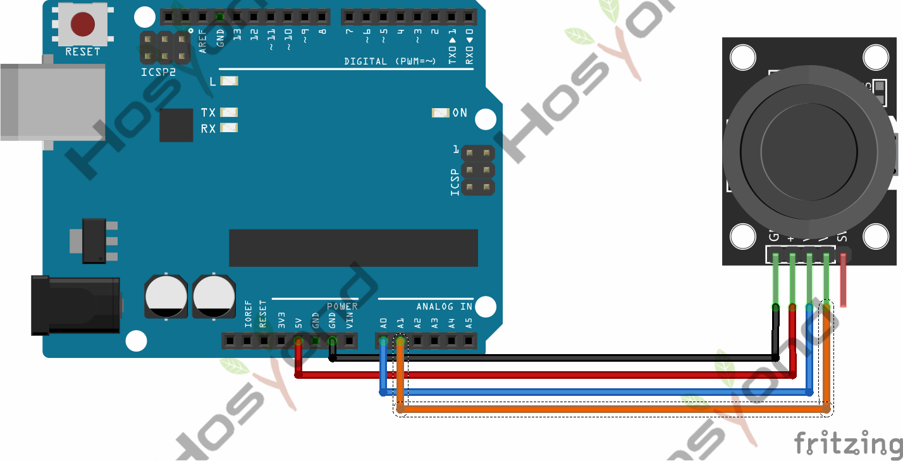
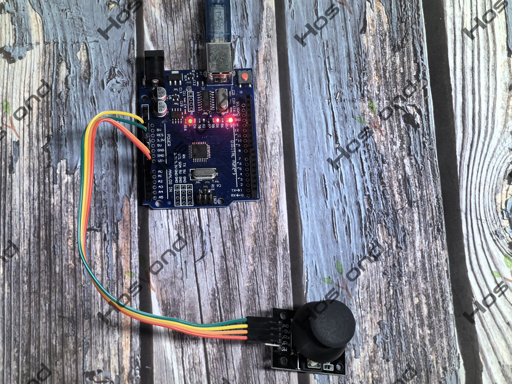

# Project 20: Joystick

## Description
Lots of robot projects need joystick.   This module provides an affordable solution.

## Specifications
- Supply Voltage: 3.3V to 5V
- Interface: Analog x2, Digital x1
- Size: 40*28mm
- Weight: 12g

## Connection Diagram
See connection diagram image: [`img/connect/20_bb.png`](../../docs/source/img/connect/20_bb.png)

## Arduino Code
- Sketch file: [`20.Joystick.ino`](./20.Joystick.ino)

## Expected Phenomenon
See phenomenon photo: [`img/phenomenon/20.jpg`](../../docs/source/img/phenomenon/20.jpg)

## Documentation
- Sphinx source: [`docs/source/20.Joystick.rst`](../../docs/source/20.Joystick.rst)
- Offline HTML page: [`docs/build/html/20.Joystick.html`](../../docs/build/html/20.Joystick.html)
