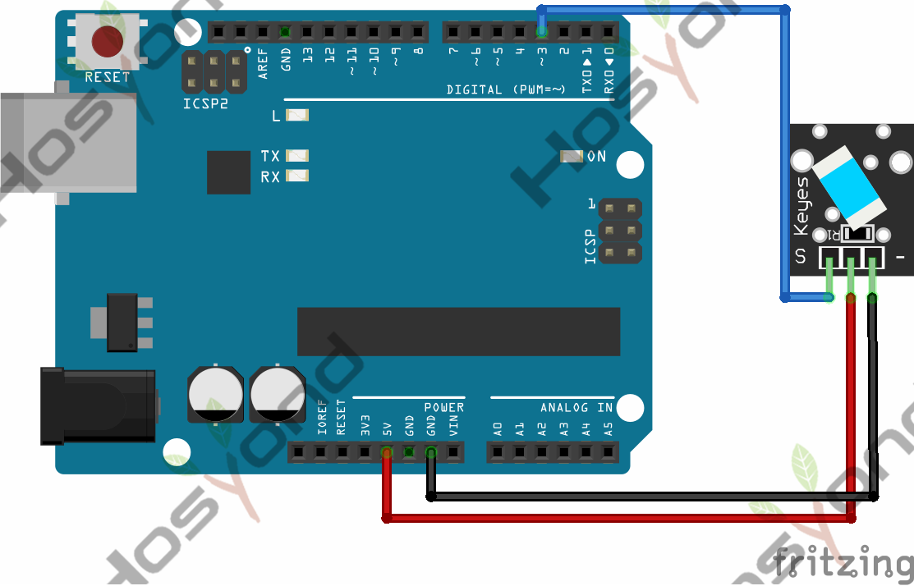
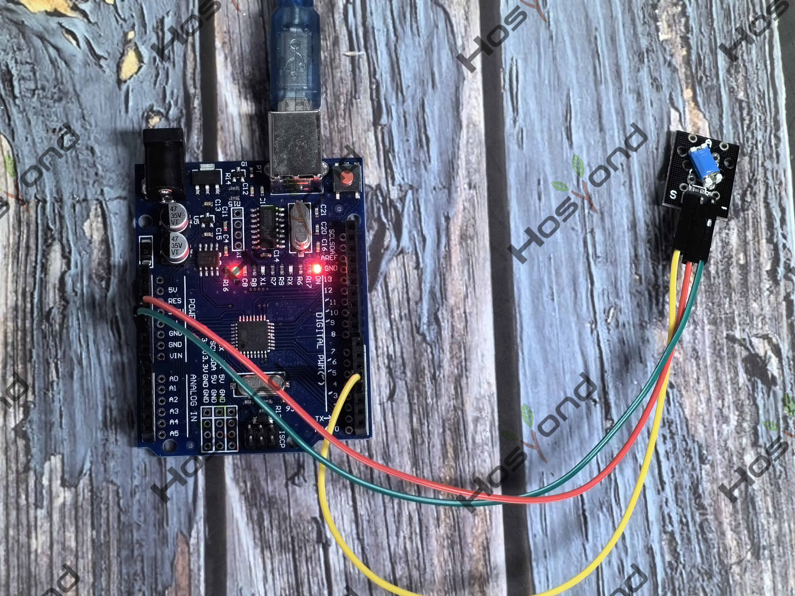

# Project 21: Tilt switch

## Description
Tilt Sensor is a digital tilt switch. It can be used as a simple tilt switch.

## Specifications
- Supply Voltage: 3.3V to 5V
- Interface: Digital
- Size: 30*20mm
- Weight: 3g

## Connection Diagram
See connection diagram image: [`img/connect/21_bb.png`](../../docs/source/img/connect/21_bb.png)

## Arduino Code
- Sketch file: [`21.Tilt_Switch.ino`](./21.Tilt_Switch.ino)

## Expected Phenomenon
See phenomenon photo: [`img/phenomenon/21.jpg`](../../docs/source/img/phenomenon/21.jpg)

## Documentation
- Sphinx source: [`docs/source/21.tilt_switch.rst`](../../docs/source/21.tilt_switch.rst)
- Offline HTML page: [`docs/build/html/21.tilt_switch.html`](../../docs/build/html/21.tilt_switch.html)
