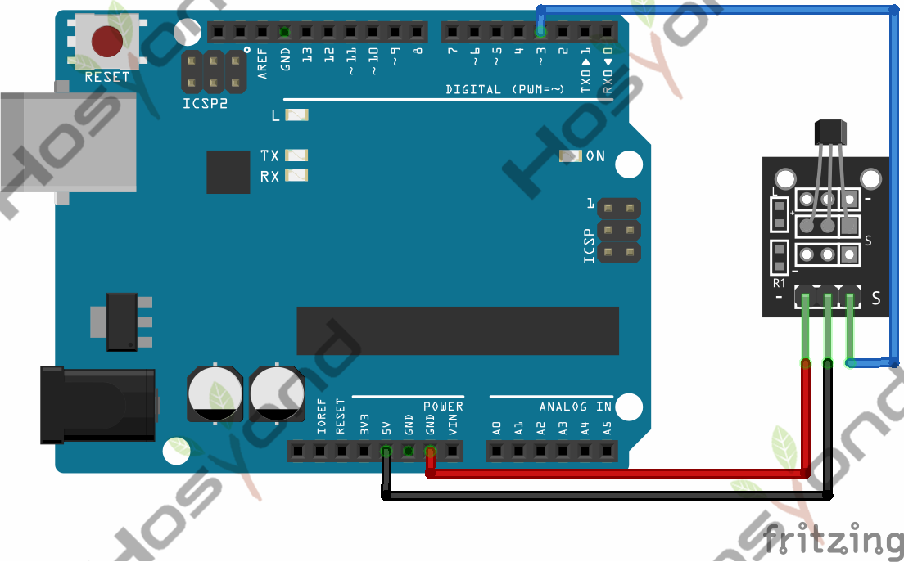
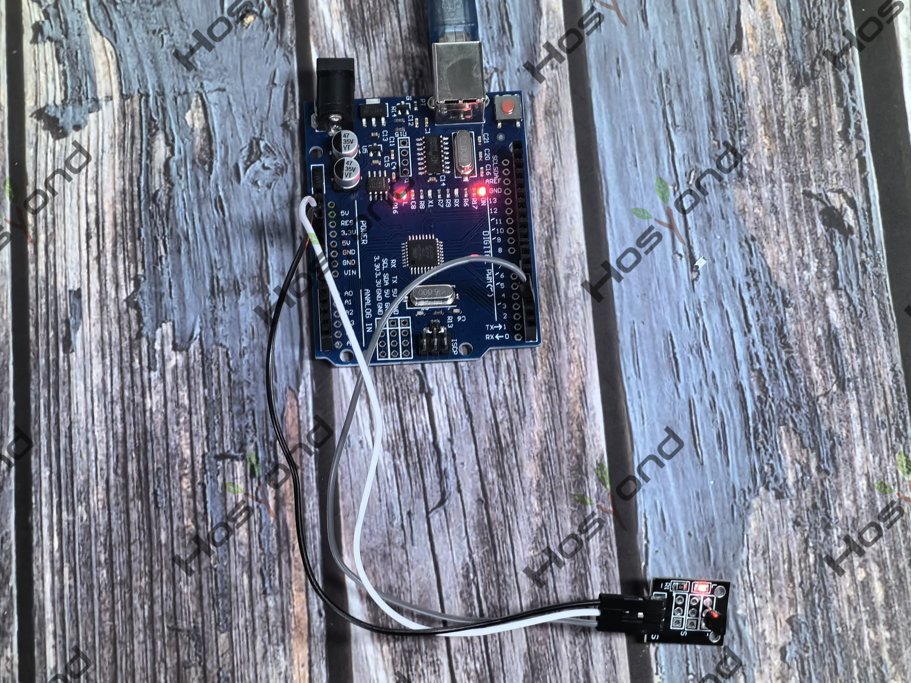

# Project 22: KY-035 Hall Sensor

## Description
This is a magnetic induction sensor. It can sense the magnetic materials within 
a detection range up to 3cm.

## Specifications
- Sensing magnetic materials
- Detection range: up to 3cm
- Output: digital on/off
- Size: 30*20mm
- Weight: 3g

## Connection Diagram
See connection diagram image: [`img/connect/22_bb.png`](../../docs/source/img/connect/22_bb.png)

## Arduino Code
- Sketch file: [`22.Hall_Magnetic_Sensor.ino`](./22.Hall_Magnetic_Sensor.ino)

## Expected Phenomenon
See phenomenon photo: [`img/phenomenon/22.jpg`](../../docs/source/img/phenomenon/22.jpg)

## Documentation
- Sphinx source: [`docs/source/22.ky-035_hall_sensor.rst`](../../docs/source/22.ky-035_hall_sensor.rst)
- Offline HTML page: [`docs/build/html/22.ky-035_hall_sensor.html`](../../docs/build/html/22.ky-035_hall_sensor.html)
