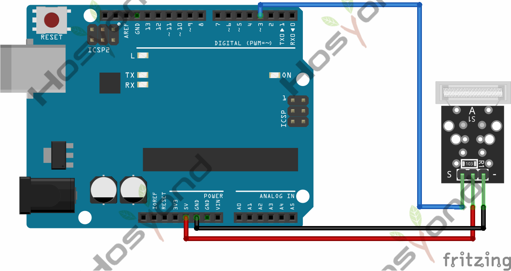
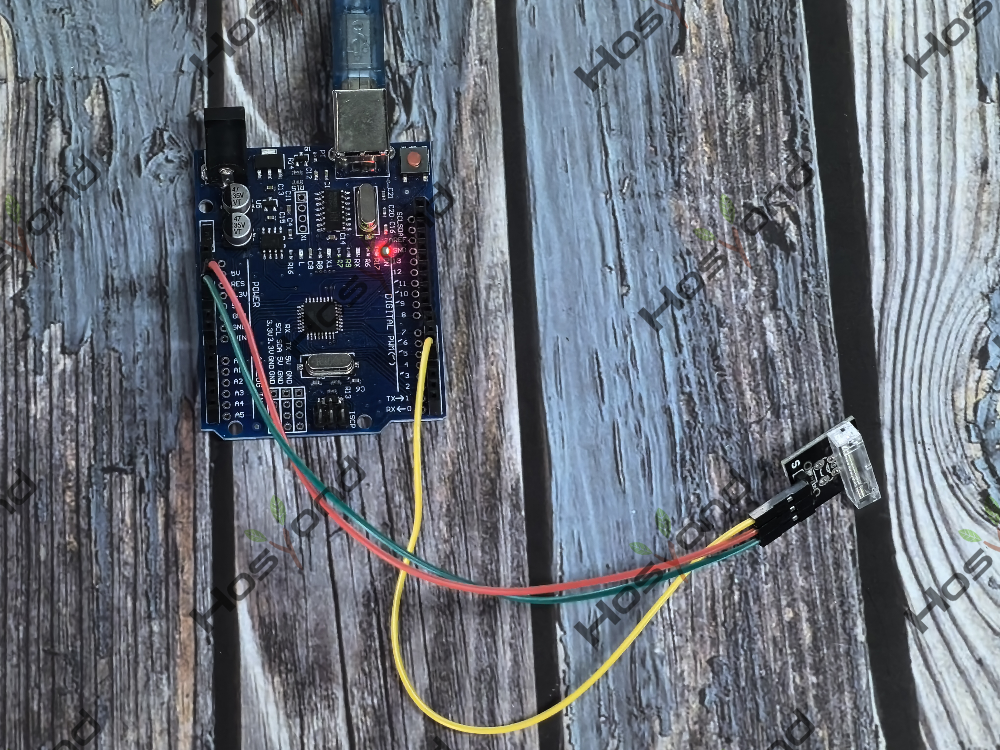

# Project 23: TAP Module

## Description
This module is a knock sensor. When you knock it, it can send a momentary signal.

## Specifications
- Working voltage: 5V
- Size: 30*20mm
- Weight: 3g

## Connection Diagram
See connection diagram image: [`img/connect/23_bb.png`](../../docs/source/img/connect/23_bb.png)

## Arduino Code
- Sketch file: [`23.TAP_Module.ino`](./23.TAP_Module.ino)

## Expected Phenomenon
See phenomenon photo: [`img/phenomenon/23.jpg`](../../docs/source/img/phenomenon/23.jpg)

## Documentation
- Sphinx source: [`docs/source/23.tap_module.rst`](../../docs/source/23.tap_module.rst)
- Offline HTML page: [`docs/build/html/23.tap_module.html`](../../docs/build/html/23.tap_module.html)
