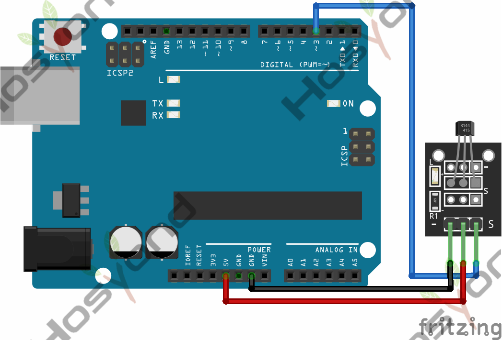
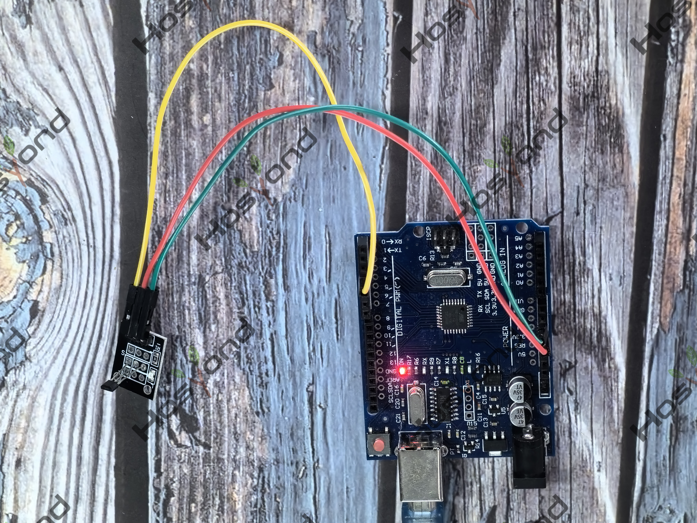

# Project 24: KY-003 Hall Sensor

## Description
The KY-003 Hall Magnetic Sensor module is a switch that reacts to the presence 
of a magnetic field, turning itself on or off. Compatible with popular microcont
rolers like Arduino, Raspberry Pi and ESP32.This module offers a digital output.

## Specifications
- Operating Voltage	4.5V to 24V
- Operating Temperature Range	-40°C to 85°C
- Board Dimensions	18.5mm x 15mm

## Connection Diagram
See connection diagram image: [`img/connect/24_bb.png`](../../docs/source/img/connect/24_bb.png)

## Arduino Code
- Sketch file: [`24.Hall_Magnetic_Sensor.ino`](./24.Hall_Magnetic_Sensor.ino)

## Expected Phenomenon
See phenomenon photo: [`img/phenomenon/24.jpg`](../../docs/source/img/phenomenon/24.jpg)

## Documentation
- Sphinx source: [`docs/source/24.ky-003_hall_sensor.rst`](../../docs/source/24.ky-003_hall_sensor.rst)
- Offline HTML page: [`docs/build/html/24.ky-003_hall_sensor.html`](../../docs/build/html/24.ky-003_hall_sensor.html)
