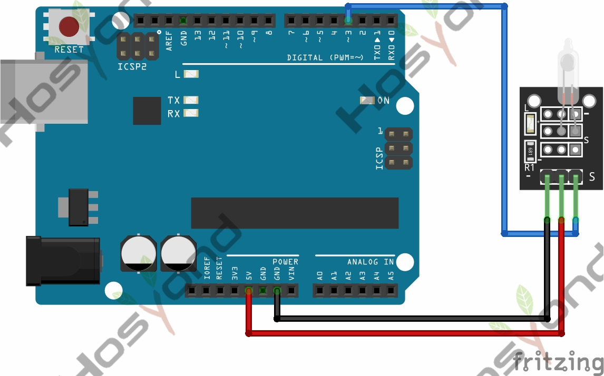
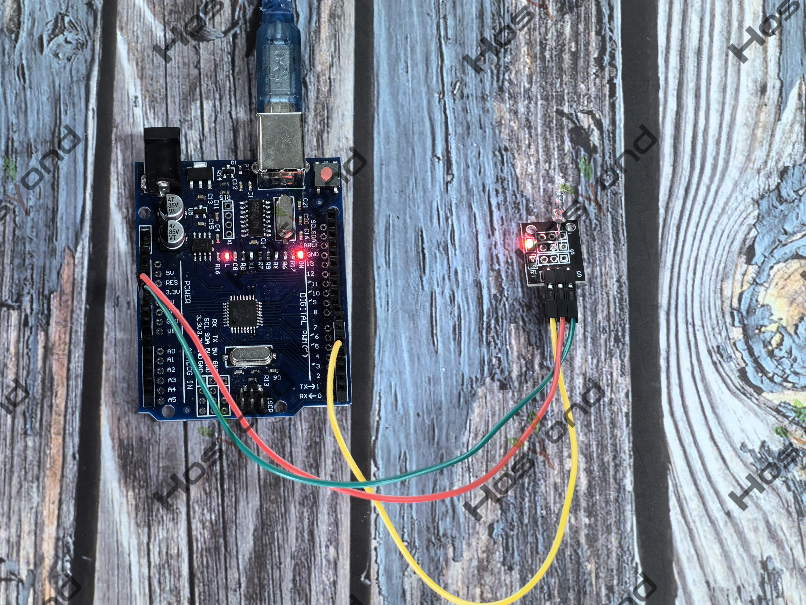

# Project 25: Mercury Tilt Switch

## Description

## Specifications
- Operating Voltage	3.3V ~ 5.5V

## Connection Diagram
See connection diagram image: [`img/connect/25_bb.png`](../../docs/source/img/connect/25_bb.png)

## Arduino Code
- Sketch file: [`25.Mercury_Tilt_Switch.ino`](./25.Mercury_Tilt_Switch.ino)

## Expected Phenomenon
See phenomenon photo: [`img/phenomenon/25.jpg`](../../docs/source/img/phenomenon/25.jpg)

## Documentation
- Sphinx source: [`docs/source/25.mercury_tilt_switch.rst`](../../docs/source/25.mercury_tilt_switch.rst)
- Offline HTML page: [`docs/build/html/25.mercury_tilt_switch.html`](../../docs/build/html/25.mercury_tilt_switch.html)
