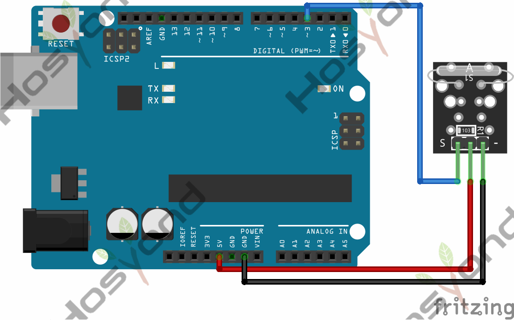
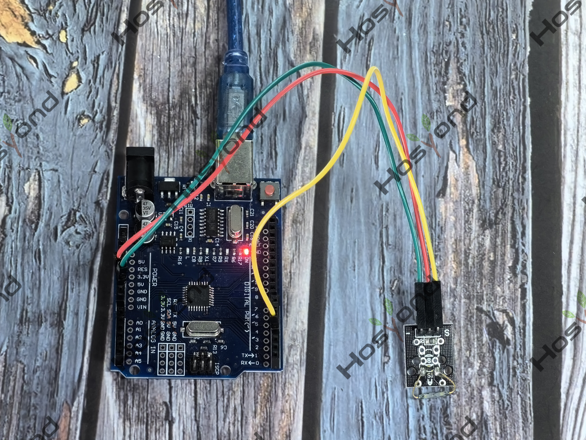

# Project 26: Reed Switch

## Description
The KY-021 Magnetic Reed Switch module is a switch that is normally open and gets 
closed when exposed to a magnetic field, sending a digital signal. Commonly used 
in mechanical systems as proximity sensors.

## Specifications
- Operating Voltage	3.3V ~ 5V
- Output Type	Digital
- Board Size	18.5mm x 15mm

## Connection Diagram
See connection diagram image: [`img/connect/26_bb.png`](../../docs/source/img/connect/26_bb.png)

## Arduino Code
- Sketch file: [`26.Reed_Switch.ino`](./26.Reed_Switch.ino)

## Expected Phenomenon
See phenomenon photo: [`img/phenomenon/26.jpg`](../../docs/source/img/phenomenon/26.jpg)

## Documentation
- Sphinx source: [`docs/source/26.reed_switch.rst`](../../docs/source/26.reed_switch.rst)
- Offline HTML page: [`docs/build/html/26.reed_switch.html`](../../docs/build/html/26.reed_switch.html)
