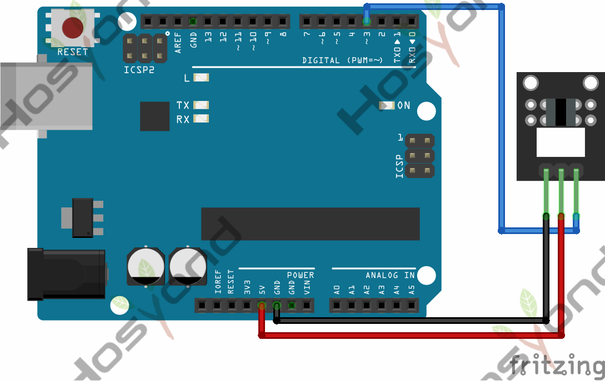
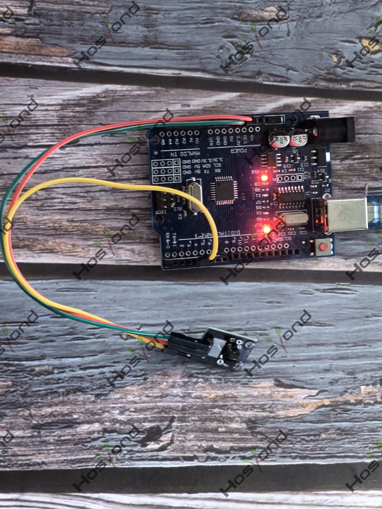

# Project 27: Photo Interrupter Module

## Description
The KY-010 Photo Interrupter module is a switch that will trigger a signal when light between the sensor’s gap is blocked.

## Specifications
- Operating Voltage	3.3V ~ 5V
- Board Dimensions	 18.5mm x 15mm

## Connection Diagram
See connection diagram image: [`img/connect/27_bb.png`](../../docs/source/img/connect/27_bb.png)

## Arduino Code
- Sketch file: [`27.Photo_Interrupter_Module.ino`](./27.Photo_Interrupter_Module.ino)

## Expected Phenomenon
See phenomenon photo: [`img/phenomenon/27.jpg`](../../docs/source/img/phenomenon/27.jpg)

## Documentation
- Sphinx source: [`docs/source/27.photo_interrupter_module.rst`](../../docs/source/27.photo_interrupter_module.rst)
- Offline HTML page: [`docs/build/html/27.photo_interrupter_module.html`](../../docs/build/html/27.photo_interrupter_module.html)
