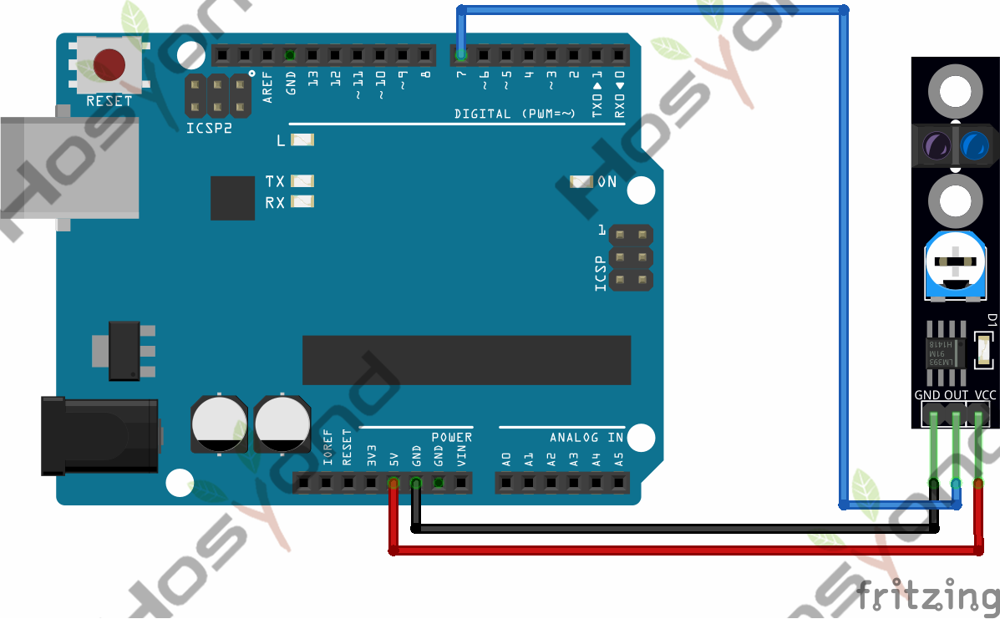
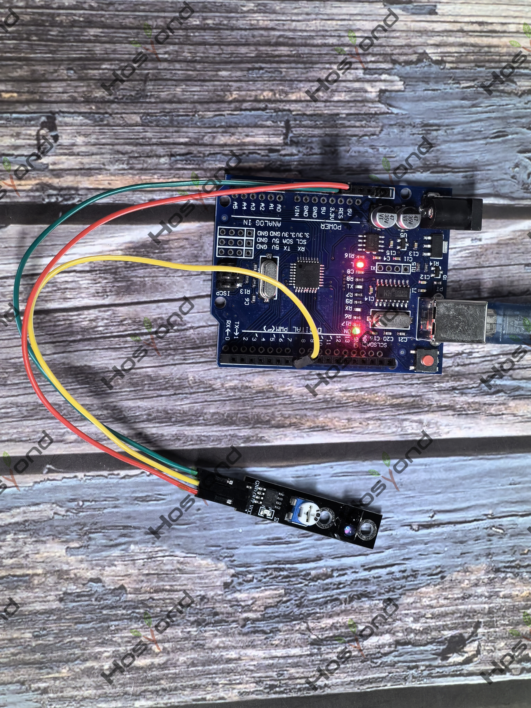

# Project 28: Line Tracking Sensor Module

## Description
The KY-033 Line Tracking module is an infrared sensor that detects whether the 
surface in front of it is reflective or opaque. Sensitivity to ambient light can 
be adjusted using the knob to achieve a fairly accurate reading.

## Specifications
- Working voltage	3.3V — 5.5V DC
- Output signal	TTL level (high level if line detected, low if no line detected)
- Board Size	1cm x 4.2cm

## Connection Diagram
See connection diagram image: [`img/connect/28_bb.png`](../../docs/source/img/connect/28_bb.png)

## Arduino Code
- Sketch file: [`28.Line_Tracking_Sensor_Module.ino`](./28.Line_Tracking_Sensor_Module.ino)

## Expected Phenomenon
See phenomenon photo: [`img/phenomenon/28.jpg`](../../docs/source/img/phenomenon/28.jpg)

## Documentation
- Sphinx source: [`docs/source/28.line_tracking_sensor_module.rst`](../../docs/source/28.line_tracking_sensor_module.rst)
- Offline HTML page: [`docs/build/html/28.line_tracking_sensor_module.html`](../../docs/build/html/28.line_tracking_sensor_module.html)
