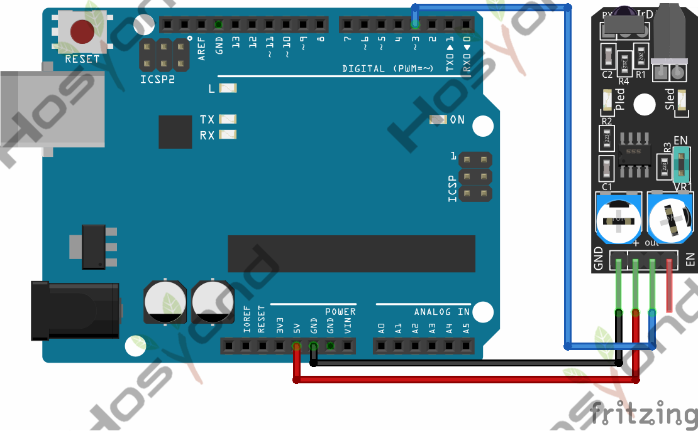
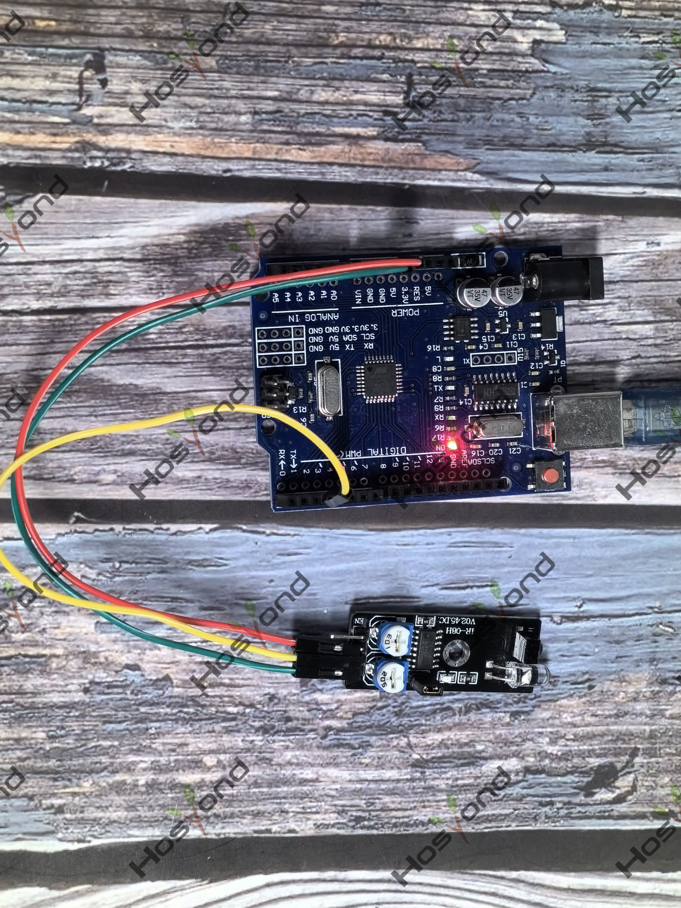

# Project 29: Infrared Obstacle Avoidance Sensor Module

## Description
The module has a pair of infrared LEDs, an emitter, and a receiver. The emitting

## Specifications
- Working voltage	3.3V – 5V DC
- Working current	≥ 20mA
- Working temperature	-10°C – 50°C
- Detection distance 	2cm – 40cm
- IO interface	4-wire interface (/EN/+/S/-)
- Output signal	TTL level (low level if obstacle detected, high if no obstacle)
- Adjustment method	multi-turn resistance adjustment
- Effective angle	35°
- Board Size	1.6cm x 4cm [0.62in x 1.57in]
- Weight	9g

## Connection Diagram
See connection diagram image: [`img/connect/29_bb.png`](../../docs/source/img/connect/29_bb.png)

## Arduino Code
- Sketch file: [`29.Infrared_Obstacle_Avoidance_Sensor_Module.ino`](./29.Infrared_Obstacle_Avoidance_Sensor_Module.ino)

## Expected Phenomenon
See phenomenon photo: [`img/phenomenon/29.jpg`](../../docs/source/img/phenomenon/29.jpg)

## Documentation
- Sphinx source: [`docs/source/29.infrared_obstacle_avoidance_sensor_module.rst`](../../docs/source/29.infrared_obstacle_avoidance_sensor_module.rst)
- Offline HTML page: [`docs/build/html/29.infrared_obstacle_avoidance_sensor_module.html`](../../docs/build/html/29.infrared_obstacle_avoidance_sensor_module.html)
