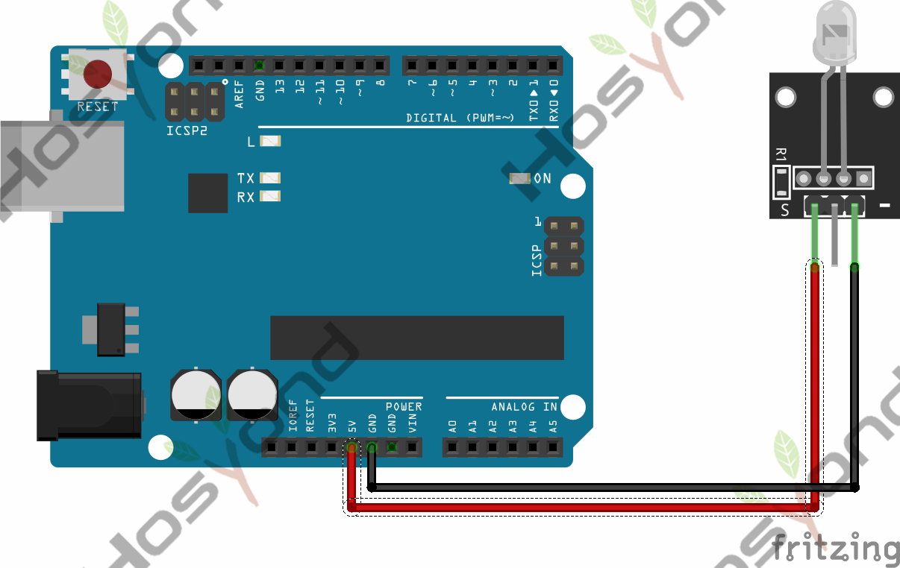
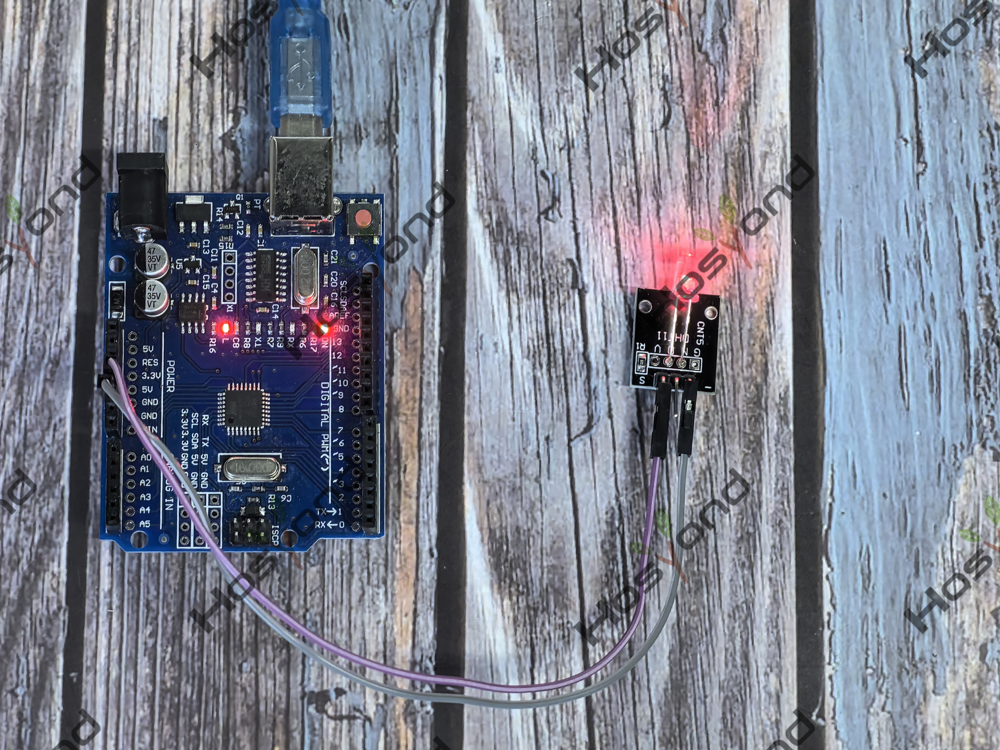

# Project 3: 7 Color Flash

## Description
This is a seven-color flashing module that can emit seven colors, including red, green, and blue.

## Specifications
- Color: 7
- Brightness: High
- Voltage: 5V
- Input: Digital Level
- Size: 30*20mm
- Weight: 3g

## Connection Diagram
See connection diagram image: [`img/connect/3_bb.png`](../../docs/source/img/connect/3_bb.png)

## Operation
This is a direct hardware module. No microcontroller sketch code is required.

## Expected Phenomenon
See phenomenon photo: [`img/phenomenon/3.jpg`](../../docs/source/img/phenomenon/3.jpg)

## Documentation
- Sphinx source: [`docs/source/3.7_color_flash.rst`](../../docs/source/3.7_color_flash.rst)
- Offline HTML page: [`docs/build/html/3.7_color_flash.html`](../../docs/build/html/3.7_color_flash.html)
