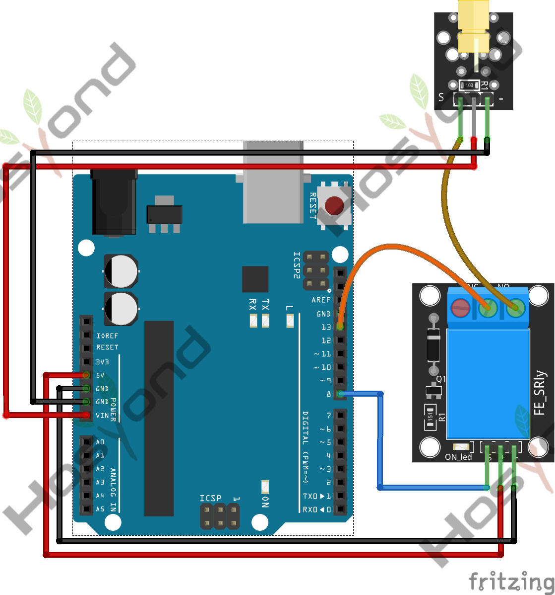
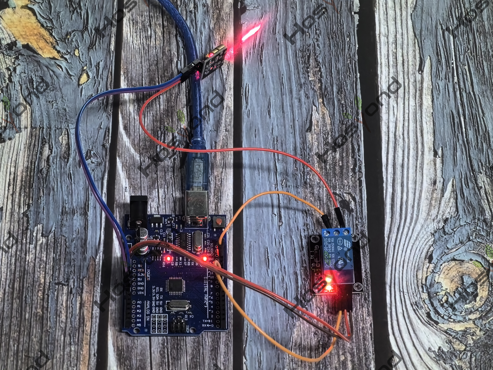

# Project 30: Relay

## Description
The KY-019 consist of a 1MΩ resistor, a LED, a 1N4007 rectifier diode and a 5VDC 
relay capable of handling up to 250VAC and 10A.

## Specifications
- TTL Control Signal	5VDC to 12VDC (some boards may work with 3.3)
- Maximum AC	10A 250VAC
- Maximum DC	10A 30VDC
- Contact Type	NC and NO
- Board Dimensions	27mm x 34mm

## Connection Diagram
See connection diagram image: [`img/connect/30_bb.png`](../../docs/source/img/connect/30_bb.png)

## Arduino Code
- Sketch file: [`30.Relay.ino`](./30.Relay.ino)

## Expected Phenomenon
See phenomenon photo: [`img/phenomenon/30.jpg`](../../docs/source/img/phenomenon/30.jpg)

## Documentation
- Sphinx source: [`docs/source/30.relay.rst`](../../docs/source/30.relay.rst)
- Offline HTML page: [`docs/build/html/30.relay.html`](../../docs/build/html/30.relay.html)
