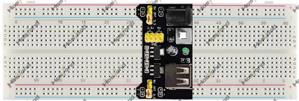

# Project 31: Breadboard Power Supply Module

## Description
The 3.3V/5V output MB102 Breadboard power supply module is an easy to use, most 
useful breadboard component that can be added with any breadboard related projects 
where 5V, 3.3V or both power requirements are required. Its ease of use allows users 
to connect any DC power supply unit that has 6.5-12 VDC power output from a barrel jack.

## Specifications
- Input voltage: 6.5 - 12V
- Two Independent Channel
- Output voltage: 5V, 3.3V (adjustable via jumpers. 0V, 3.3V, and 5V configuration)
- Output current: Maximum output current 700mA
- Onboard berg male header for GND, 5V, 3.3V output
- ON-OFF Switch available.
- USB (Type-A) input available.
- DC Barrel Jack input available.
- Onboard power LED
- Dimension: 53mm x 33mm (L x W)

## Operation
This is a direct hardware module. No microcontroller sketch code is required.

## Expected Phenomenon
See phenomenon photo: [`img/phenomenon/31-2.jpg`](../../docs/source/img/phenomenon/31-2.jpg)

## Documentation
- Sphinx source: [`docs/source/31.breadboard_power_supply_module.rst`](../../docs/source/31.breadboard_power_supply_module.rst)
- Offline HTML page: [`docs/build/html/31.breadboard_power_supply_module.html`](../../docs/build/html/31.breadboard_power_supply_module.html)
