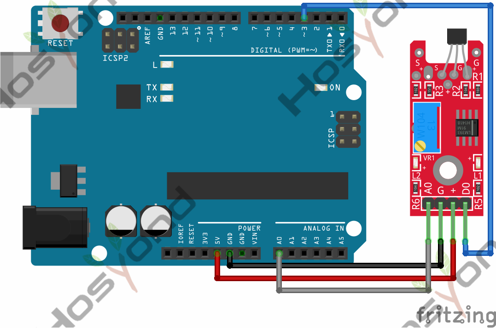
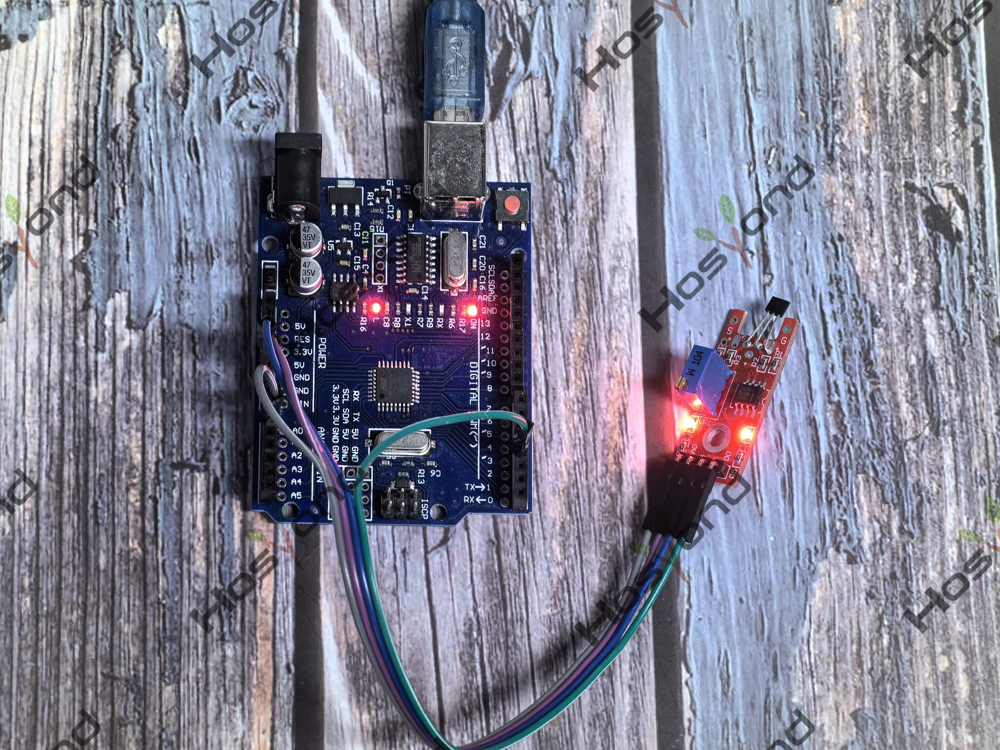

# Project 32: Linear Magnetic Hall Module

## Description
The KY-024 Linear magnetic Hall sensor reacts in the presence of a magnetic field.

## Specifications
- Operating Voltage	2.7V to 6.5V
- Sensitivity	1.0 mV/G min., 1.4 mV/G typ., 1.75 mV/G max.
- Board Dimensions	1.5cm x 3.6cm

## Connection Diagram
See connection diagram image: [`img/connect/32_bb.png`](../../docs/source/img/connect/32_bb.png)

## Arduino Code
- Sketch file: [`32.Linear_Magnetic_Hall_Module.ino`](./32.Linear_Magnetic_Hall_Module.ino)

## Expected Phenomenon
See phenomenon photo: [`img/phenomenon/32.jpg`](../../docs/source/img/phenomenon/32.jpg)

## Documentation
- Sphinx source: [`docs/source/32.linear_magnetic_hall_module.rst`](../../docs/source/32.linear_magnetic_hall_module.rst)
- Offline HTML page: [`docs/build/html/32.linear_magnetic_hall_module.html`](../../docs/build/html/32.linear_magnetic_hall_module.html)
