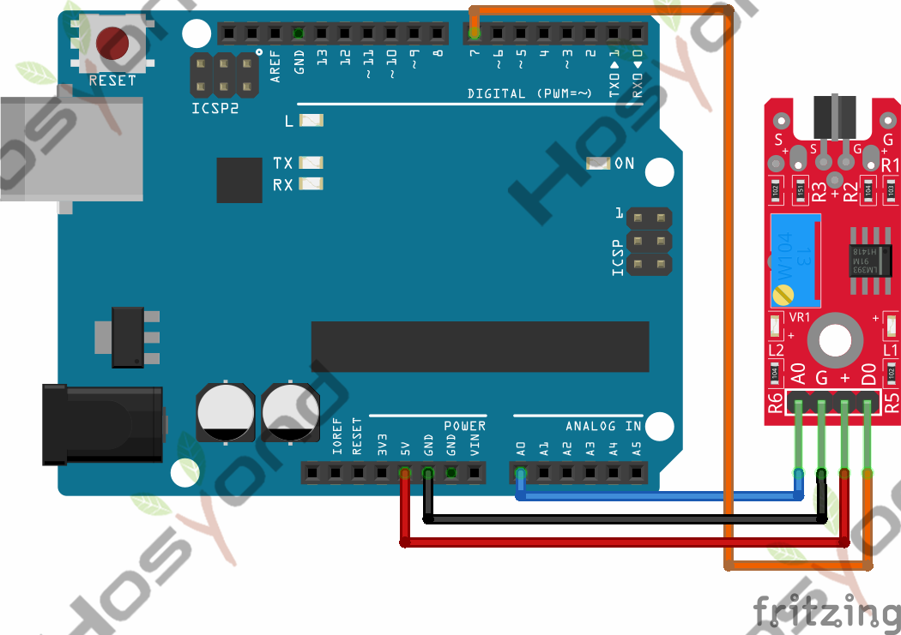
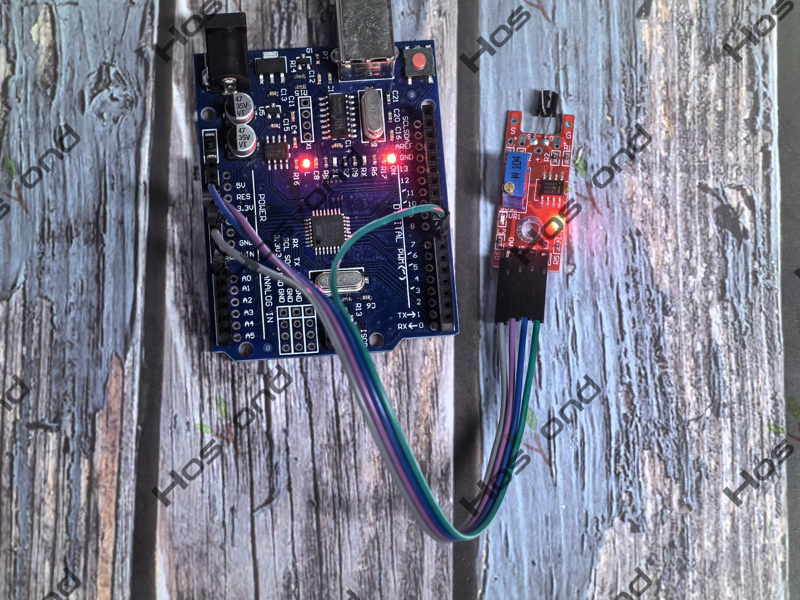

# Project 33: Metal Touch Sensor Module

## Description
The KY-036 Metal Touch Sensor Module is an analog/digital sensor that uses a 
transistor to detect changes in electrical conductivity. When the transistor is 
touched with a finger, the conductivity changes and the module emits a digital 
and analog signal.

## Specifications
- Operating voltage	3.3V ~ 5.5V
- Board Dimensions	15mm x 36mm

## Connection Diagram
See connection diagram image: [`img/connect/33_bb.png`](../../docs/source/img/connect/33_bb.png)

## Arduino Code
- Sketch file: [`33.Metal_Touch_Sensor_Module.ino`](./33.Metal_Touch_Sensor_Module.ino)

## Expected Phenomenon
See phenomenon photo: [`img/phenomenon/33.jpg`](../../docs/source/img/phenomenon/33.jpg)

## Documentation
- Sphinx source: [`docs/source/33.metal_touch_sensor_module.rst`](../../docs/source/33.metal_touch_sensor_module.rst)
- Offline HTML page: [`docs/build/html/33.metal_touch_sensor_module.html`](../../docs/build/html/33.metal_touch_sensor_module.html)
