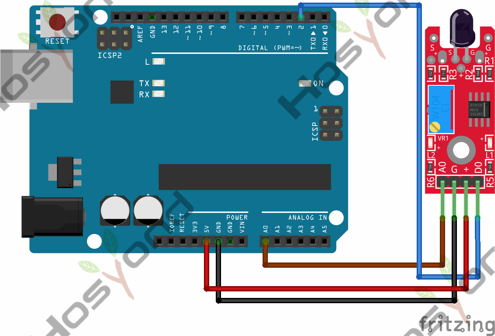
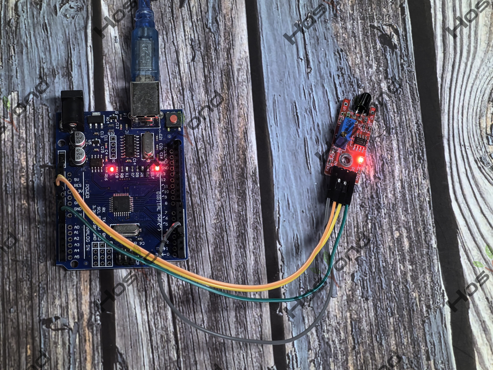

# Project 34: Flame Sensor Module

## Description
The KY-026 Flame Sensor module detects infrared light emitted by fire. This 
module has both digital and analog outputs and a potentiometer to adjust the 
sensitivity. Commonly used in fire detection systems.

## Specifications
- Operating Voltage	3.3V ~ 5.5V
- Infrared Wavelength Detection	760nm ~ 1100nm
- Sensor Detection Angle	60°
- Board Dimensions	1.5cm x 3.6cm

## Connection Diagram
See connection diagram image: [`img/connect/34_bb.png`](../../docs/source/img/connect/34_bb.png)

## Arduino Code
- Sketch file: [`34.Flame_Sensor_Module.ino`](./34.Flame_Sensor_Module.ino)

## Expected Phenomenon
See phenomenon photo: [`img/phenomenon/34.jpg`](../../docs/source/img/phenomenon/34.jpg)

## Documentation
- Sphinx source: [`docs/source/34.flame_sensor_module.rst`](../../docs/source/34.flame_sensor_module.rst)
- Offline HTML page: [`docs/build/html/34.flame_sensor_module.html`](../../docs/build/html/34.flame_sensor_module.html)
