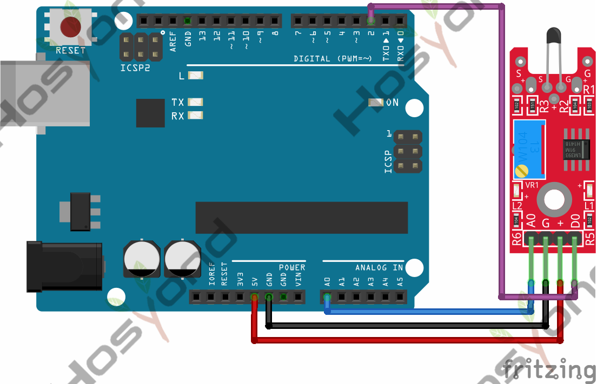
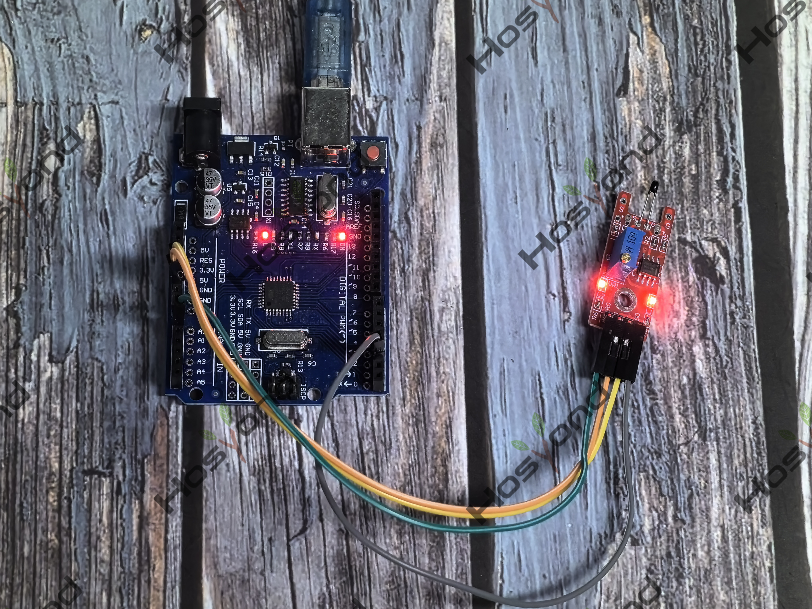

# Project 35: Digital Temperature Sensor Module

## Description
The KY-028 Digital Temperature Sensor measures temperature changes based on thermistor 
resistance. This module has both digital and analog outputs, there’s a potentiometer to 
djust the detection threshold on the digital interface.

## Specifications
- Operating Voltage	3.3V ~ 5.5V
- Temperature Measurement Range	-55°C to 125°C
- Measurement Accuracy	±0.5°C
- Board Dimensions	15mm x 36mm

## Connection Diagram
See connection diagram image: [`img/connect/35_bb.png`](../../docs/source/img/connect/35_bb.png)

## Arduino Code
- Sketch file: [`35.Digital_Temperature_Sensor_Module.ino`](./35.Digital_Temperature_Sensor_Module.ino)

## Expected Phenomenon
See phenomenon photo: [`img/phenomenon/35.jpg`](../../docs/source/img/phenomenon/35.jpg)

## Documentation
- Sphinx source: [`docs/source/35.digital_temperature_sensor_module.rst`](../../docs/source/35.digital_temperature_sensor_module.rst)
- Offline HTML page: [`docs/build/html/35.digital_temperature_sensor_module.html`](../../docs/build/html/35.digital_temperature_sensor_module.html)
