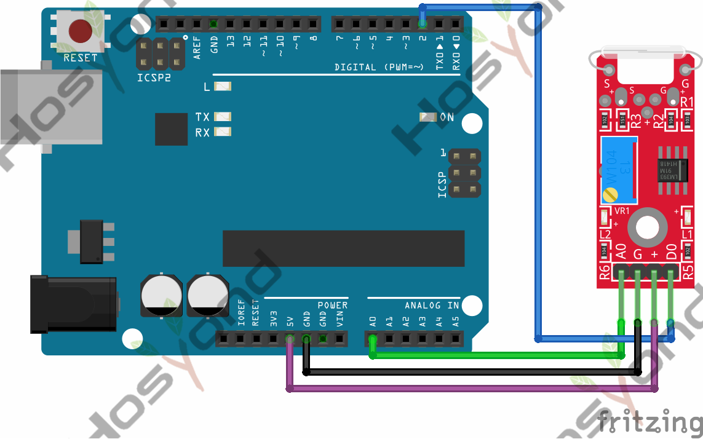
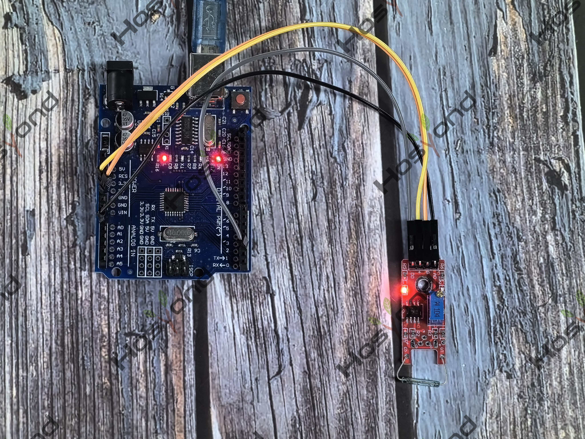

# Project 36: Reed Switch Module

## Description
The KY-025 Reed Switch Module is a small electrical switch operated by an applied 
magnetic field, commonly used as proximity sensor.

## Specifications
Operation Voltage	3.3V ~ 5.5V

## Connection Diagram
See connection diagram image: [`img/connect/36_bb.png`](../../docs/source/img/connect/36_bb.png)

## Arduino Code
- Sketch file: [`36.Reed_Switch_Module.ino`](./36.Reed_Switch_Module.ino)

## Expected Phenomenon
See phenomenon photo: [`img/phenomenon/36.jpg`](../../docs/source/img/phenomenon/36.jpg)

## Documentation
- Sphinx source: [`docs/source/36.reed_switch_module.rst`](../../docs/source/36.reed_switch_module.rst)
- Offline HTML page: [`docs/build/html/36.reed_switch_module.html`](../../docs/build/html/36.reed_switch_module.html)
