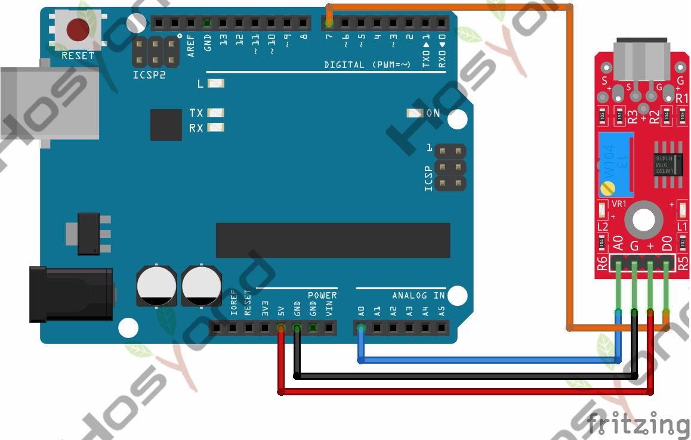
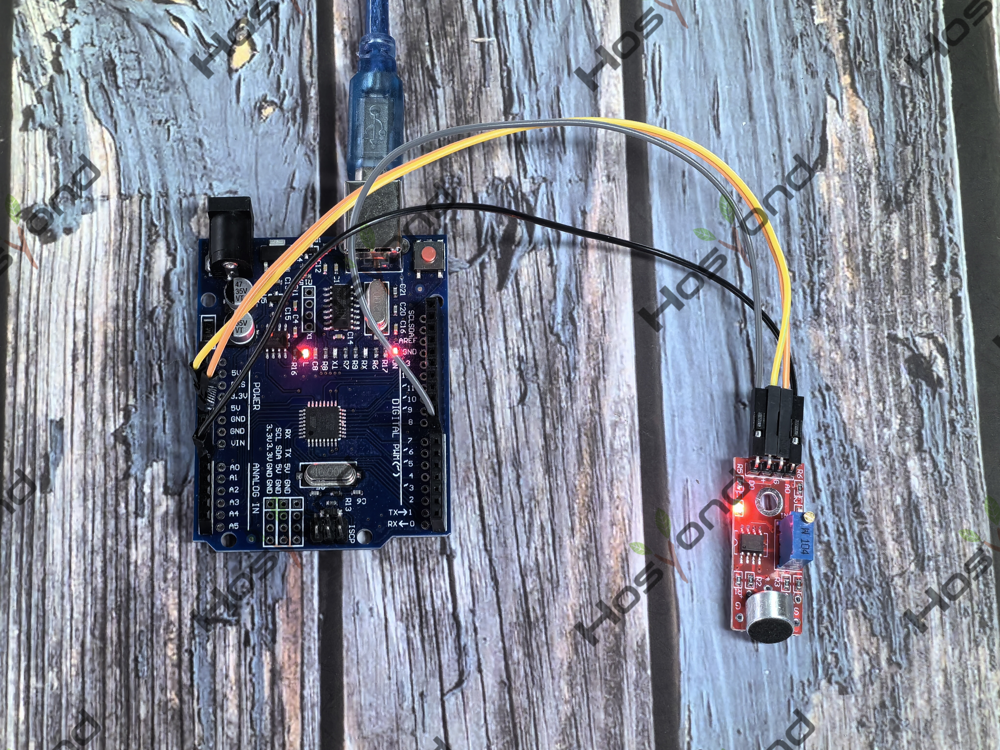

# Project 37: High Sensitivity Sound Detection Module

## Description
The KY-037 high sensitivity sound detection module is an analog/digital sensor 
that uses a condenser microphone to observe changes in environment noise. Generally 
used to detect sound above certain levels. It has a potentiometer to set the noise 
detection threshold.

## Specifications
- Operating voltage	3.3V ~ 5.5V
- Microphone sensitivity	-42 ±3 db
- Current consumption	~0.5mA
- Board Dimensions	15mm x 36mm

## Connection Diagram
See connection diagram image: [`img/connect/37_bb.png`](../../docs/source/img/connect/37_bb.png)

## Arduino Code
- Sketch file: [`37_High_Sensitivity_Sound_Detection_Module.ino`](./37_High_Sensitivity_Sound_Detection_Module.ino)
- Sketch file: [`37_High_Sensitivity_Sound_Detection_Module_copy_20240524112919.ino`](./37_High_Sensitivity_Sound_Detection_Module_copy_20240524112919.ino)

## Expected Phenomenon
See phenomenon photo: [`img/phenomenon/37.jpg`](../../docs/source/img/phenomenon/37.jpg)

## Documentation
- Sphinx source: [`docs/source/37.high_sensitivity_sound_detection_module.rst`](../../docs/source/37.high_sensitivity_sound_detection_module.rst)
- Offline HTML page: [`docs/build/html/37.high_sensitivity_sound_detection_module.html`](../../docs/build/html/37.high_sensitivity_sound_detection_module.html)
