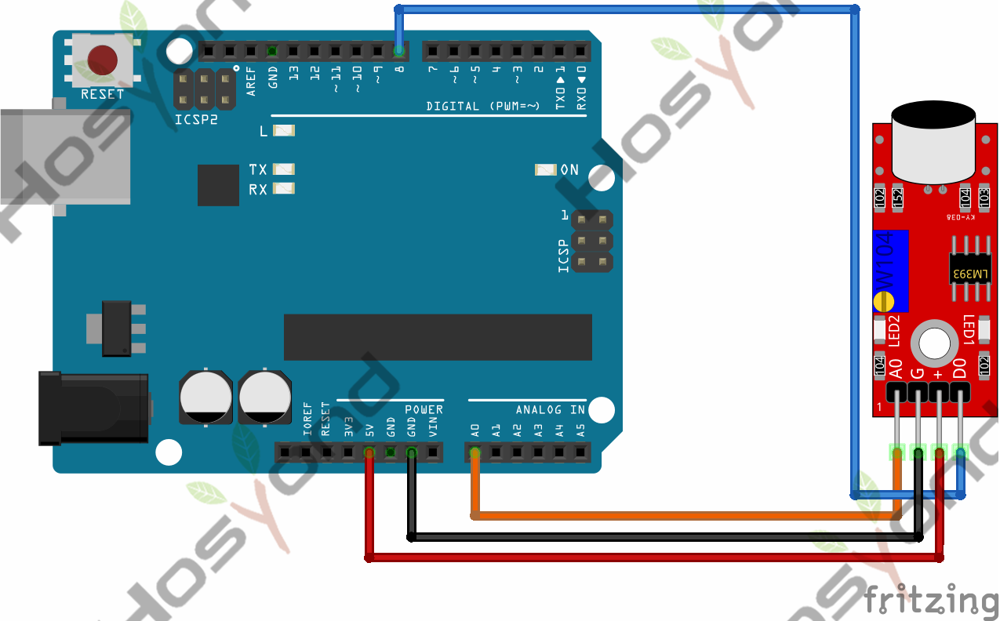
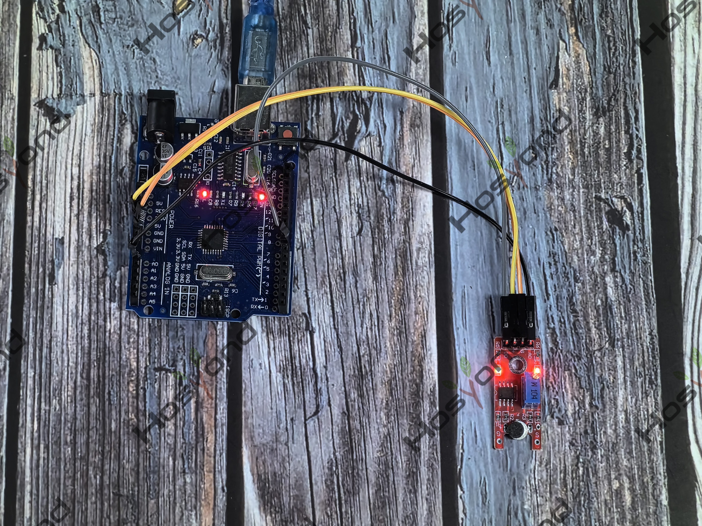

# Project 38: Microphone Sound Sensor Module

## Description
In this tutorial, we will learn about the KY-038 module, how it works and we will 
build a simple project using the KY-038 module and an Arduino.The KY-038 Module 
will be our main component for this tutorial.

## Specifications
- Operation Voltage	3.3V ~ 5.5V
- Board Dimensions	1.5cm x 3.5cm
- Weight: 3.1g

## Connection Diagram
See connection diagram image: [`img/connect/38_bb.png`](../../docs/source/img/connect/38_bb.png)

## Arduino Code
- Sketch file: [`38_Microphone_Sound_Sensor_Module.ino`](./38_Microphone_Sound_Sensor_Module.ino)
- Sketch file: [`38_Microphone_Sound_Sensor_Module_copy_20240524112949.ino`](./38_Microphone_Sound_Sensor_Module_copy_20240524112949.ino)

## Expected Phenomenon
See phenomenon photo: [`img/phenomenon/38.jpg`](../../docs/source/img/phenomenon/38.jpg)

## Documentation
- Sphinx source: [`docs/source/38.microphone_sound_sensor_module.rst`](../../docs/source/38.microphone_sound_sensor_module.rst)
- Offline HTML page: [`docs/build/html/38.microphone_sound_sensor_module.html`](../../docs/build/html/38.microphone_sound_sensor_module.html)
