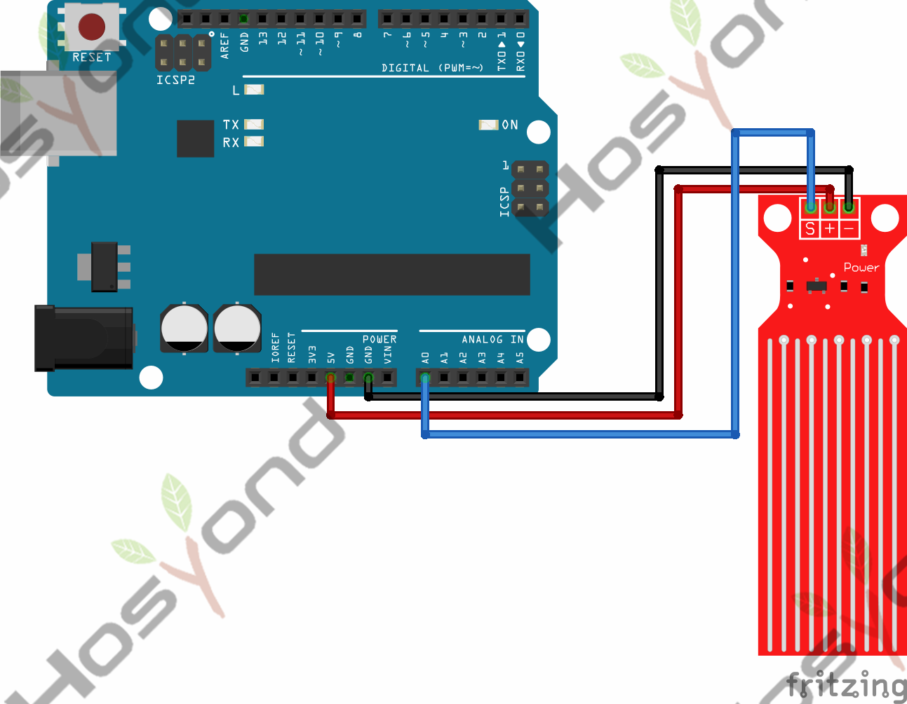
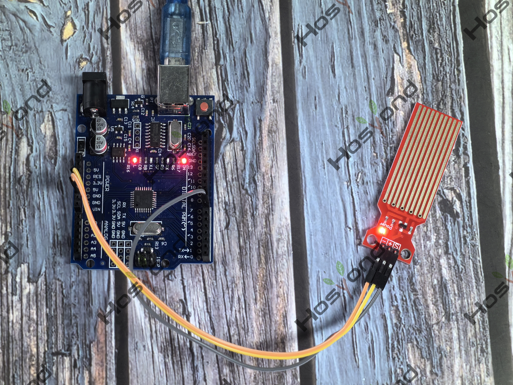

# Project 39: Water Level Sensor

## Description
The sensor has ten exposed copper traces, five of which are power traces and the 
remaining five are sense traces. These traces are interlaced so that there is 
one sense trace between every two power traces.

## Specifications
- Working voltage: DC3-5V
- Sensor type: simulation
- Work current: less than 20mA
- Detective area: 40mmx16mm
- Work temperature: 10 ℃ -30 ℃

## Connection Diagram
See connection diagram image: [`img/connect/39_bb.png`](../../docs/source/img/connect/39_bb.png)

## Arduino Code
- Sketch file: [`39.Water_Level_Sensor.ino`](./39.Water_Level_Sensor.ino)

## Expected Phenomenon
See phenomenon photo: [`img/phenomenon/39.jpg`](../../docs/source/img/phenomenon/39.jpg)

## Documentation
- Sphinx source: [`docs/source/39.water_level_sensor.rst`](../../docs/source/39.water_level_sensor.rst)
- Offline HTML page: [`docs/build/html/39.water_level_sensor.html`](../../docs/build/html/39.water_level_sensor.html)
