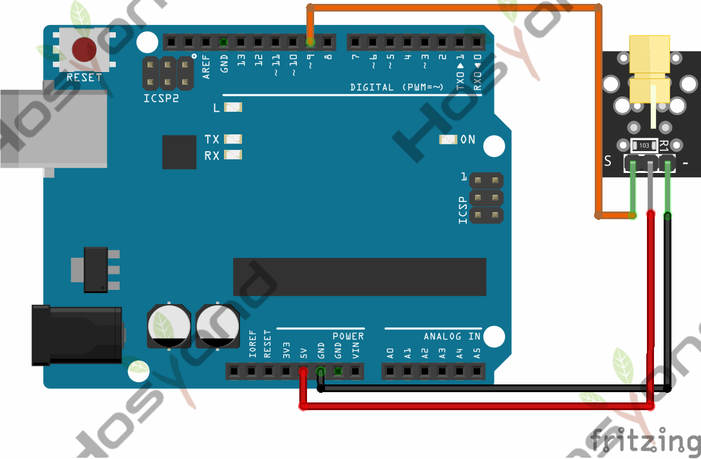
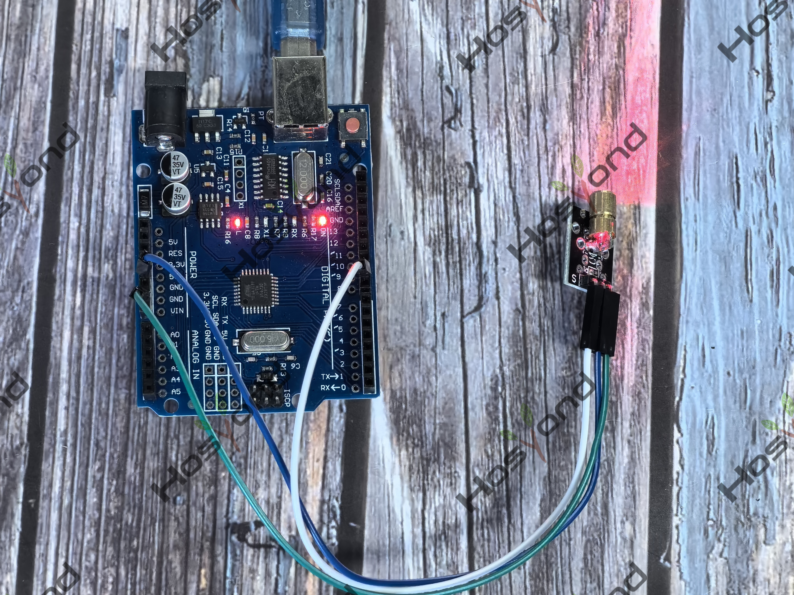

# Project 4: Laser Module

## Description
The KY-008 is a laser transmitter module that creates a dot-shaped laser beam 
that can be used as a laser pointer or to create mini laser shows.

## Specifications
- Wavelength: 650 nm (Red)
- Laser Power: 5 mW
- Operating Voltage: 3-5 volts
- Operating Current: ~ 30 mA

## Connection Diagram
See connection diagram image: [`img/connect/4_bb.png`](../../docs/source/img/connect/4_bb.png)

## Arduino Code
- Sketch file: [`4.Laser_Module.ino`](./4.Laser_Module.ino)

## Expected Phenomenon
See phenomenon photo: [`img/phenomenon/4.jpg`](../../docs/source/img/phenomenon/4.jpg)

## Documentation
- Sphinx source: [`docs/source/4.laser_module.rst`](../../docs/source/4.laser_module.rst)
- Offline HTML page: [`docs/build/html/4.laser_module.html`](../../docs/build/html/4.laser_module.html)
