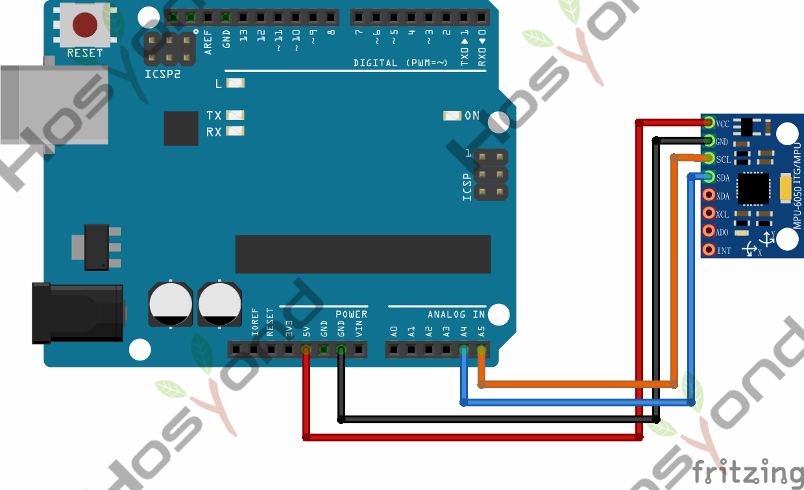
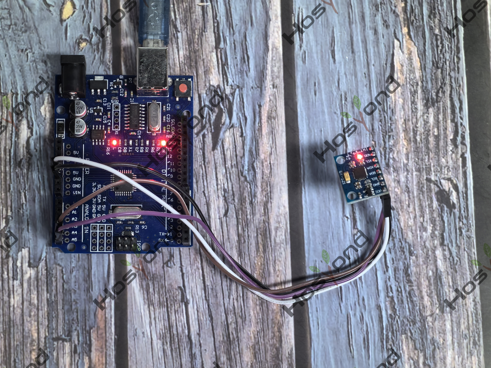

# Project 40: GY521 Module

## Description
The GY-521 module features a 3-axis gyroscope, a 3-axis accelerometer, a digital 
motion processor (DMP), and a temperature sensor.The digital motion processor can 
be used to process complex algorithms directly on the board.

## Specifications
- Chip Used: MPU-6050
- Power Supply: 3-5V (internal low-dropout voltage regulator)
- Communication Method: Standard I2C communication protocol
- Built-in 16-bit AD converter, 16-bit data output
- Gyroscope Range: ±250, ±500, ±1000, ±2000 °/s
- Accelerometer Range: ±2, ±4, ±8, ±16g

## Connection Diagram
See connection diagram image: [`img/connect/40_bb.png`](../../docs/source/img/connect/40_bb.png)

## Arduino Code
- Sketch file: [`40.GY521_Module.ino`](./40.GY521_Module.ino)

## Expected Phenomenon
See phenomenon photo: [`img/phenomenon/40.jpg`](../../docs/source/img/phenomenon/40.jpg)

## Documentation
- Sphinx source: [`docs/source/40.gy521_module.rst`](../../docs/source/40.gy521_module.rst)
- Offline HTML page: [`docs/build/html/40.gy521_module.html`](../../docs/build/html/40.gy521_module.html)
