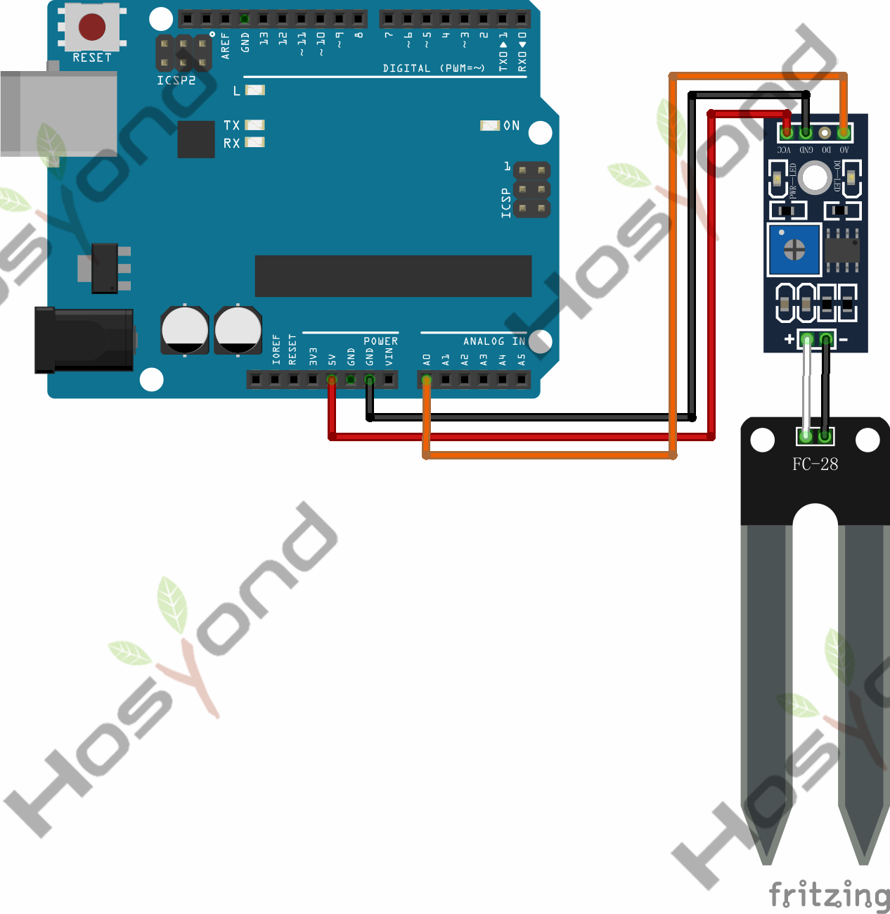
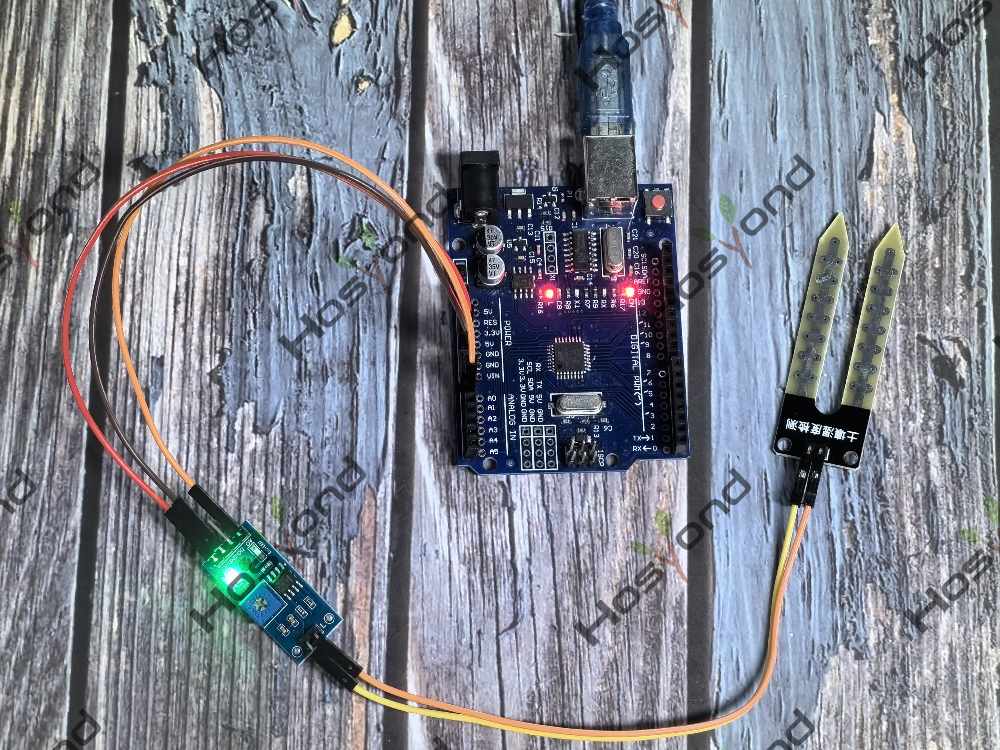

# Project 42: Soil Moisture Sensor

## Description
The soil moisture sensor or the hygrometer is usually used to detect the humidity 
of the soil. So, it is perfect to build an automatic watering system or to monitor 
the soil moisture of your plants.

## Specifications
Connect
--------
.. image:: /img/connect/42_bb.png

## Connection Diagram
See connection diagram image: [`img/connect/42_bb.png`](../../docs/source/img/connect/42_bb.png)

## Arduino Code
- Sketch file: [`42.Soil_Moisture_Sensor.ino`](./42.Soil_Moisture_Sensor.ino)

## Expected Phenomenon
See phenomenon photo: [`img/phenomenon/42.jpg`](../../docs/source/img/phenomenon/42.jpg)

## Documentation
- Sphinx source: [`docs/source/42.soil_moisture_sensor.rst`](../../docs/source/42.soil_moisture_sensor.rst)
- Offline HTML page: [`docs/build/html/42.soil_moisture_sensor.html`](../../docs/build/html/42.soil_moisture_sensor.html)
