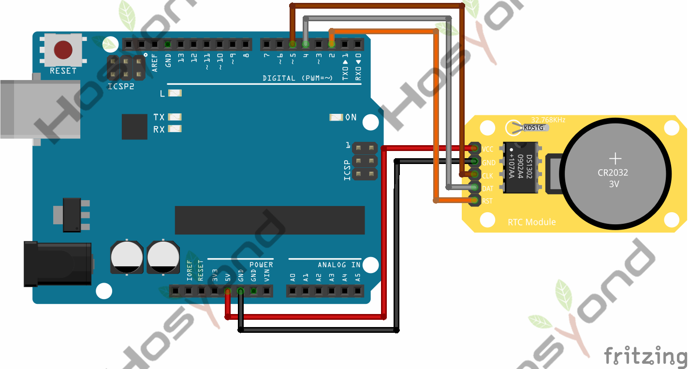
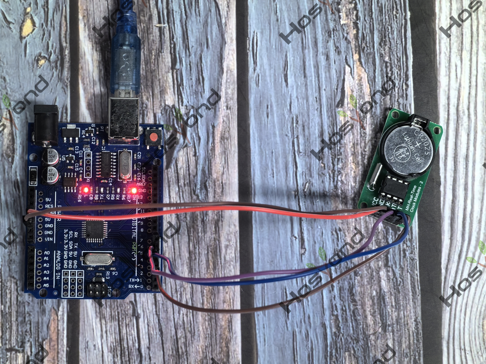

# Project 43: Ds1302 Rtc Module

## Description
The DS1320 RTC is a compact real time battery backed clock module capable of 
accurately keeping the current time and date. It includes a 24 hour clock consisting 
of hours, minutes & seconds and a calendar which stores the current year in 2 digits, 
month and date. The calendar is also capable of correcting for months with different 
amounts of days and leap years. Additionally there is a day of the week counter to 
keep track of the current date.

## Specifications
2.0V to 5.5V Full Operation

## Connection Diagram
See connection diagram image: [`img/connect/43_bb.png`](../../docs/source/img/connect/43_bb.png)

## Arduino Code
- Sketch file: [`43.Ds1302_Rtc_Module.ino`](./43.Ds1302_Rtc_Module.ino)

## Expected Phenomenon
See phenomenon photo: [`img/phenomenon/43.jpg`](../../docs/source/img/phenomenon/43.jpg)

## Documentation
- Sphinx source: [`docs/source/43.ds1302_rtc_module.rst`](../../docs/source/43.ds1302_rtc_module.rst)
- Offline HTML page: [`docs/build/html/43.ds1302_rtc_module.html`](../../docs/build/html/43.ds1302_rtc_module.html)
