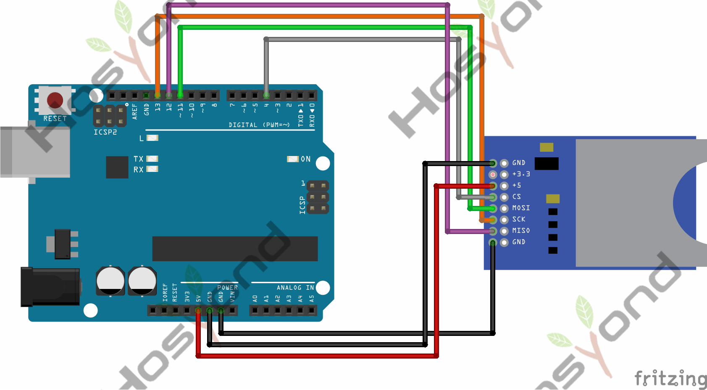
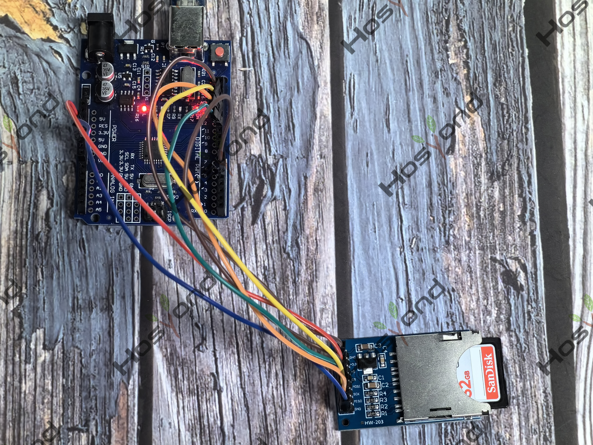

# Project 44: SD Card Info

## Description
Specification
--------------

## Specifications
Product weight: 10g

## Connection Diagram
See connection diagram image: [`img/connect/44_bb.png`](../../docs/source/img/connect/44_bb.png)

## Arduino Code
- Sketch file: [`44.SD_Card_Info.ino`](./44.SD_Card_Info.ino)

## Expected Phenomenon
See phenomenon photo: [`img/phenomenon/44.jpg`](../../docs/source/img/phenomenon/44.jpg)

## Documentation
- Sphinx source: [`docs/source/44.sd_card_info.rst`](../../docs/source/44.sd_card_info.rst)
- Offline HTML page: [`docs/build/html/44.sd_card_info.html`](../../docs/build/html/44.sd_card_info.html)
