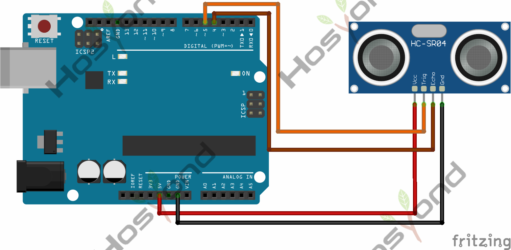
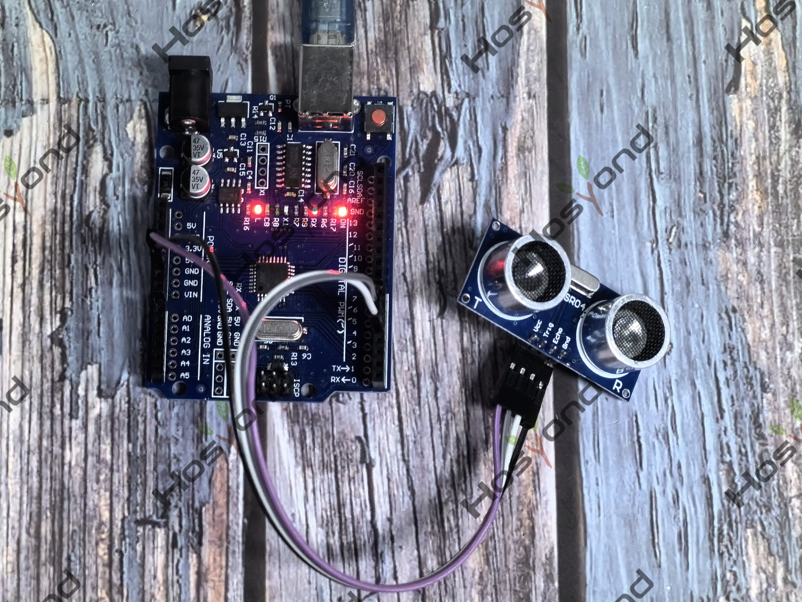

# Project 45: Ultrasonic Module

## Description
As the ultrasonic has strong directivity, slow energy consumption and far spread 
distance in the media, so it is commonly used in the measurement of distance, 
such as range finder and position measuring instrument. Ultrasonic detector 
module can provide 2cm-450cm non-contact sensing distance, and its ranging accuracy 
is up to 3mm, very good to meet the normal requirements. The module includes an 
ultrasonic transmitter and receiver as well as the corresponding control circuit.

## Specifications
- Working voltage：0.5V(DC)
- Working current：15mA
- Detecting range：2-450cm
- Detecting angle：15 degrees
- Input trigger pulse：10us TTL Level
- Output echo signal： output TTL level signal(HIGH)，proportional to range.

## Connection Diagram
See connection diagram image: [`img/connect/45_bb.png`](../../docs/source/img/connect/45_bb.png)

## Arduino Code
- Sketch file: [`45.Ultrasonic_Module.ino`](./45.Ultrasonic_Module.ino)

## Expected Phenomenon
See phenomenon photo: [`img/phenomenon/45.jpg`](../../docs/source/img/phenomenon/45.jpg)

## Documentation
- Sphinx source: [`docs/source/45.ultrasonic_module.rst`](../../docs/source/45.ultrasonic_module.rst)
- Offline HTML page: [`docs/build/html/45.ultrasonic_module.html`](../../docs/build/html/45.ultrasonic_module.html)
