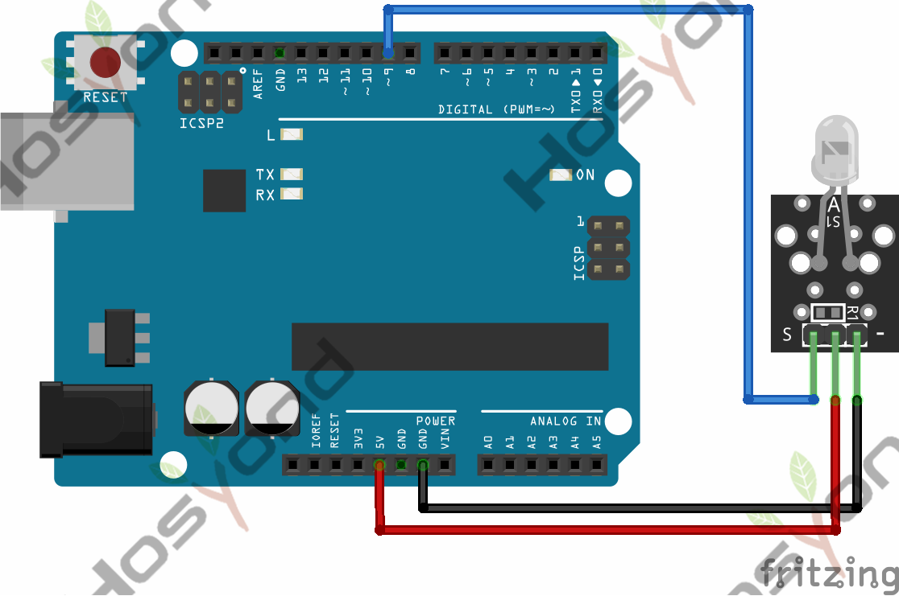
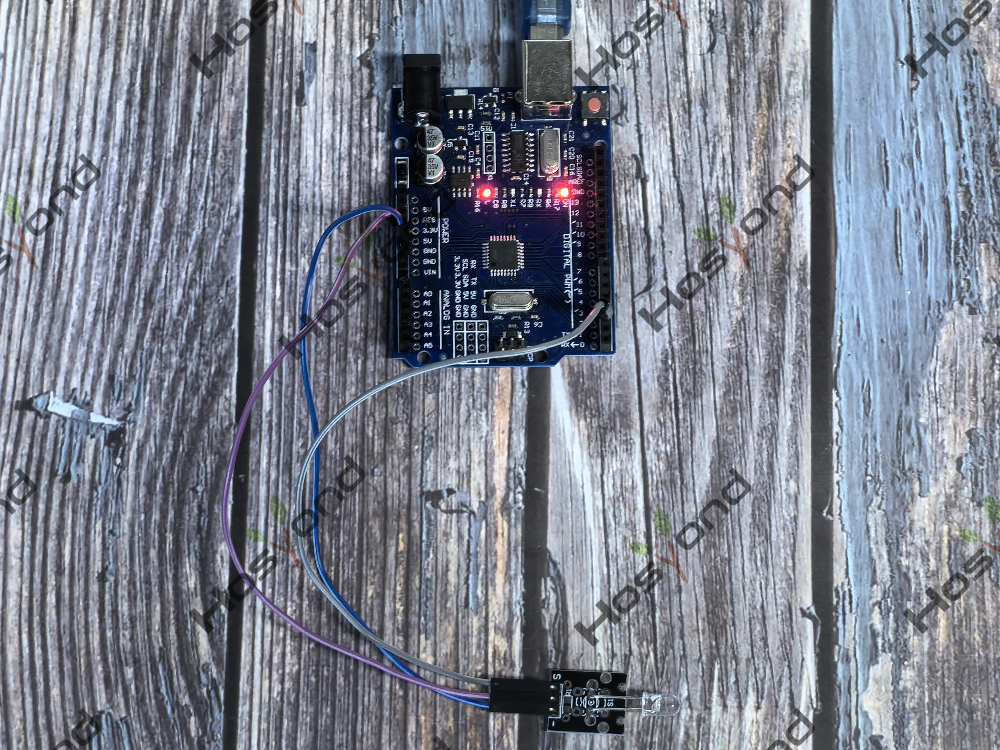

# Project 5: Digital IR Transmitters

## Description
IR transmitter module is designed for IR communication, which is widely used for
operating the television device from a short line-of-sight distance. Since 
infrared (IR) remote control uses light, it requires line of sight to operate 
the destination device. The signal can, however, be reflected by mirrors, just 
like any other light sources. Infrared receivers also tend to have a more or 
less limited operating angle, which mainly depends on the optical characteristics 
of the phototransistor. However, it’s easy to increase the operating angle 
using a matte transparent object in front of the receiver.

## Specifications
- Power Supply: 3-5V
- Infrared center frequency: 850nm-940nm
- Infrared emission angle: about 20 degrees
- Infrared emission distance: about 1.3m (5V 38Khz)
- Interface socket: JST PH2.0
- Mounting hole: inner diameter is 3.2mm, spacing is 15mm

## Connection Diagram
See connection diagram image: [`img/connect/5_bb.png`](../../docs/source/img/connect/5_bb.png)

## Arduino Code
- Sketch file: [`5.Digital_Ir_Transmitters.ino`](./5.Digital_Ir_Transmitters.ino)

## Expected Phenomenon
See phenomenon photo: [`img/phenomenon/5.jpg`](../../docs/source/img/phenomenon/5.jpg)

## Documentation
- Sphinx source: [`docs/source/5.ir_transmitters.rst`](../../docs/source/5.ir_transmitters.rst)
- Offline HTML page: [`docs/build/html/5.ir_transmitters.html`](../../docs/build/html/5.ir_transmitters.html)
