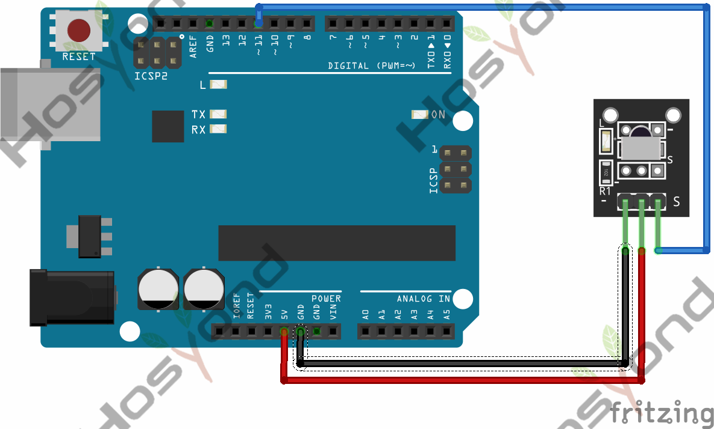
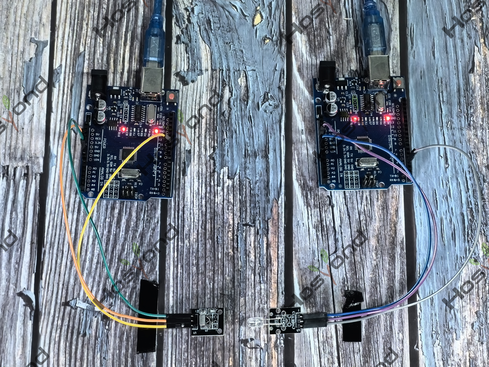

# Project 6: Digital IR Receiver

## Description
IR is widely used in remote control. With this IR receiver, Arduino project is 
able to receive command from any IR remoter controllers if you have the right 
decoder. Well, it will be also easy to make your own IR controller using IR 
transmitter.

## Specifications
- Power Supply: 5V
- Interface: Digital
- Modulation Frequency: 38Khz
- Module Interface Socket: JST PH2.0
- Size: 30*20mm
- Weight: 4g

## Connection Diagram
See connection diagram image: [`img/connect/6_bb.png`](../../docs/source/img/connect/6_bb.png)

## Arduino Code
- Sketch file: [`6.Digital_Ir_Receiver1.ino`](./6.Digital_Ir_Receiver1.ino)

## Expected Phenomenon
See phenomenon photo: [`img/phenomenon/6.jpg`](../../docs/source/img/phenomenon/6.jpg)

## Documentation
- Sphinx source: [`docs/source/6.ir_receiver.rst`](../../docs/source/6.ir_receiver.rst)
- Offline HTML page: [`docs/build/html/6.ir_receiver.html`](../../docs/build/html/6.ir_receiver.html)
