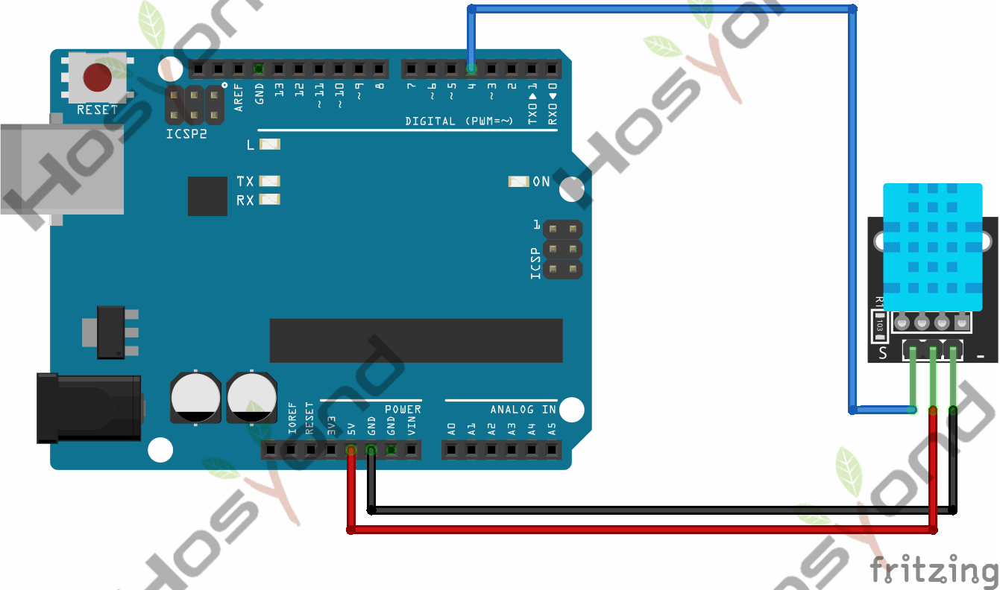

# Project 7: DHT11 Module

## Description
This DHT11 sensor features calibrated digital signal output with the temperature 
and humidity sensor complex. Its technology ensures high reliability and excellent 
long-term stability. A high-performance 8-bit microcontroller is connected on the 
sensor. This sensor includes a resistive element and a sense of wet NTC temperature 
measuring devices.It has advantages of excellent quality, fast response, anti-interference 
ability and high cost performance.

## Specifications
- Supply Voltage: +5 V
- Temperature range: 0-50 °C error of ± 2 °C
- Humidity: 20-90% RH ± 5% RH error
- Interface: Digital

## Connection Diagram
See connection diagram image: [`img/connect/7_bb.png`](../../docs/source/img/connect/7_bb.png)

## Arduino Code
- Sketch file: [`DHT11\DHT11.ino`](./DHT11/DHT11.ino)

## Documentation
- Sphinx source: [`docs/source/7.dht11_module.rst`](../../docs/source/7.dht11_module.rst)
- Offline HTML page: [`docs/build/html/7.dht11_module.html`](../../docs/build/html/7.dht11_module.html)
