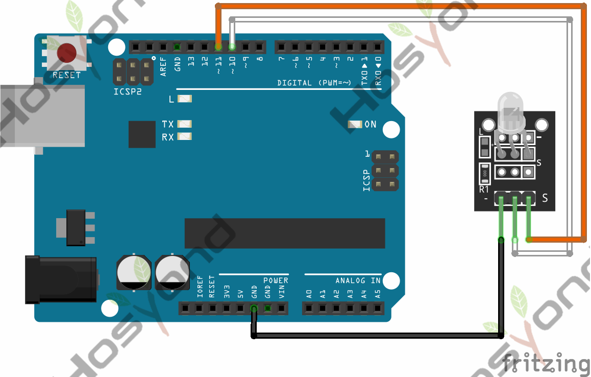
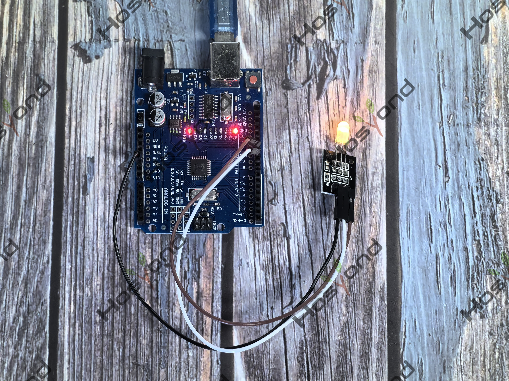

# Project 8: Double Color Led

## Description
The KY-011 Two Color LED module emits red and green light. You can adjust the 
intensity of each color using PWM.

## Specifications
- Operating Voltage	2.0v ~ 2.5v
- Working Current	10mA
- Diameter	3mm
- Package Type	Diffusion
- Color	Red + Green
- Beam Angle	150
- Wavelength	571nm + 644nm
- Luminosity Intensity (MCD)	20-40; 40-80

## Connection Diagram
See connection diagram image: [`img/connect/8_bb.png`](../../docs/source/img/connect/8_bb.png)

## Arduino Code
- Sketch file: [`8.Double_Color_Led.ino`](./8.Double_Color_Led.ino)

## Expected Phenomenon
See phenomenon photo: [`img/phenomenon/8.jpg`](../../docs/source/img/phenomenon/8.jpg)

## Documentation
- Sphinx source: [`docs/source/8.double_color_led.rst`](../../docs/source/8.double_color_led.rst)
- Offline HTML page: [`docs/build/html/8.double_color_led.html`](../../docs/build/html/8.double_color_led.html)
