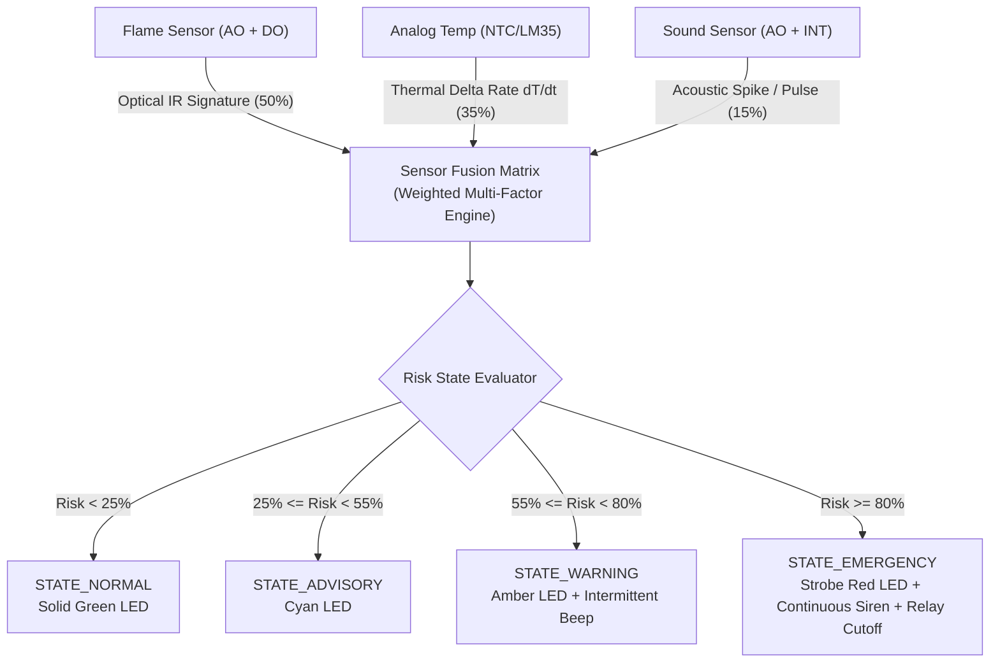

# Project 1: Multi-Sensor Environmental Hazard Guardian

## 1. Overview & Sensor Fusion Concept
Traditional fire, explosion, and hazard monitoring systems in industrial and residential embedded systems frequently fail due to two opposing problems:
1. **False Alarms:** A single photodiode flame sensor will falsely trigger from bright ambient sunlight, halogen lighting, or smartphone flashes.
2. **Thermal Lag:** A standard ambient temperature sensor can take several minutes to reach a fixed threshold (e.g. 50°C), by which time an electrical fire or chemical flare has already spread.

This **Sensor Fusion Level 1 Project** combines three distinct physical sensing domains to calculate a dynamic **Composite Risk Score (0 - 100%)**:
- **Optical Infrared Detection** (Flame Sensor Module #34)
- **Thermodynamic Rate of Change ($\frac{dT}{dt}$)** (Analog Temperature Sensor Module #13)
- **Acoustic Shockwave / Noise Detection** (High Sensitivity Sound Sensor Module #37)

---

## 2. Bill of Materials (from Hosyond 45-in-1 Kit)
| Component | Kit Module # | Function |
|---|---|---|
| Arduino Uno | Target Board | Central processing & state machine |
| Flame Sensor Module | Module #34 | Dual analog intensity & digital interrupt |
| Analog Temperature Sensor | Module #13 | Thermal rise rate calculation |
| High Sensitivity Sound Sensor | Module #37 | Acoustic anomaly & sound spike detection |
| RGB LED Module | Module #01 | 4-color status beacon |
| Active Buzzer Module | Module #11 | Audible alert siren |
| 5V Relay Module | Module #30 | Emergency power cutoff or exhaust actuation |
| Breadboard & Jumper Wires | Kit Accessories | Interconnections |

---

## 3. Arduino Uno Wiring Table
| Module | Sensor Pin | Arduino Uno Pin | Description |
|---|---|---|---|
| **Flame Sensor (#34)** | A0 (Analog) | **A0** | Raw infrared light intensity |
| | D0 (Digital) | **D4** | Fast threshold comparator |
| | VCC / GND | 5V / GND | Module Power |
| **Analog Temp (#13)** | S (Signal) | **A1** | Temperature voltage reading |
| | + / - | 5V / GND | Module Power |
| **Sound Sensor (#37)** | A0 (Analog) | **A2** | Sound wave envelope |
| | D0 (Digital) | **D2 (INT0)** | Hardware interrupt on acoustic spike |
| | VCC / GND | 5V / GND | Module Power |
| **RGB LED (#01)** | R (Red) | **D9 (PWM)** | Red color channel |
| | G (Green) | **D10 (PWM)** | Green color channel |
| | B (Blue) | **D11 (PWM)** | Blue color channel |
| | - (GND) | GND | Common Cathode ground |
| **Active Buzzer (#11)** | S (Signal) | **D8** | Siren audio control |
| | - (GND) | GND | Buzzer ground |
| **5V Relay (#30)** | IN (Signal) | **D7** | Active LOW relay trigger |
| | VCC / GND | 5V / GND | Relay coil power |

---

## 4. How It Works
1. **Calibration at Boot:** When powered on, the system takes 10 samples of the room's ambient infrared radiation, baseline temperature, and background sound floor.
2. **Rolling Derivative ($\frac{dT}{dt}$):** Rather than waiting for temperature to reach an arbitrary high number, the system calculates the derivative of temperature over a sliding 1-second window. A heating rate greater than $0.5^\circ\text{C/sec}$ indicates active combustion nearby.
3. **Hardware Interrupt Detection:** The digital sound sensor is tied to hardware interrupt pin `D2`. Sudden acoustic spikes immediately register without polling delay.
4. **Weighted Voting Decision:**
   $$\text{Composite Risk} = (0.50 \times \text{Flame}) + (0.35 \times \text{TempRate}) + (0.15 \times \text{Sound})$$
5. **Actuator Isolation:** If confirmed, Relay `#30` switches off AC power / engages exhaust, while the Active Buzzer `#11` and RGB LED `#01` deliver audio-visual alerts.
