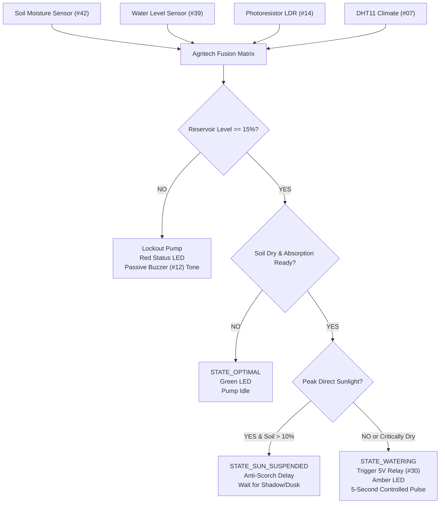

# Project 2: Smart Plant Ecosystem & Agritech Soil Hydration Guardian

## 1. Overview & Sensor Fusion Concept
Simple automated watering systems rely solely on a single soil resistance measurement. This causes severe agricultural and operational problems:
1. **Pump Burnout (Dry-Running):** If the water bucket or reservoir runs empty, the pump motor runs dry until it burns out or damages the driver.
2. **Thermal Scorch Damage:** Spraying or irrigating plant foliage under peak midday sun acts as microscopic magnifying lenses, scorching leaves and wasting up to 60% of water through rapid solar evaporation.
3. **Overwatering & Root Rot:** Without a cooldown/absorption window, water takes time to penetrate the soil sensor depth, leading to repeated unnecessary pumping cycles.

This **Sensor Fusion Level 1 Project** integrates four physical domains:
- **Dielectric Soil Moisture** (Module #42)
- **Conductive Reservoir Water Level** (Module #39)
- **Ambient Sunlight Insolation** (Photoresistor LDR Module #14)
- **Atmospheric Climate (Temp & Humidity)** (DHT11 Module #07)

---

## 2. Bill of Materials (from Hosyond 45-in-1 Kit)
| Component | Kit Module # | Function |
|---|---|---|
| Arduino Uno | Target Board | Processing & decision loop |
| Soil Moisture Sensor | Module #42 | Sub-surface soil resistance & conductivity |
| Water Level Sensor | Module #39 | Supply tank depth / dry-run prevention |
| Photoresistor Module | Module #14 | Ambient light / solar insolation tracking |
| DHT11 Sensor | Module #07 | Atmospheric temp & humidity evaluation |
| 5V Relay Module | Module #30 | Submersible water pump / solenoid trigger |
| Double Color LED | Module #08 | Red (alert) & Green (healthy) dual status |
| Passive Buzzer | Module #12 | Frequency-modulated warning tones |

---

## 3. Arduino Uno Wiring Table
| Module | Sensor Pin | Arduino Uno Pin | Description |
|---|---|---|---|
| **Soil Moisture (#42)** | S / AO | **A0** | Analog soil resistance reading |
| | + / - | 5V / GND | Power supply |
| **Water Level (#39)** | S (Signal) | **A1** | Analog reservoir immersion level |
| | + / - | 5V / GND | Power supply |
| **Photoresistor (#14)** | S (Signal) | **A2** | Ambient lux level |
| | + / - | 5V / GND | Power supply |
| **DHT11 (#07)** | S (Data) | **D4** | 1-Wire bi-directional digital data |
| | + / - | 5V / GND | Power supply |
| **5V Relay (#30)** | IN | **D7** | Active LOW relay trigger for pump |
| | VCC / GND | 5V / GND | Relay coil supply |
| **Double Color LED (#08)** | R (Red) | **D9** | Alert indicator |
| | G (Green) | **D10** | Healthy indicator |
| | - (GND) | GND | Common ground |
| **Passive Buzzer (#12)** | S (Signal) | **D8** | Warning tone audio |
| | - (GND) | GND | Buzzer ground |

---

## 4. Key Embedded Features
- **Built-in Non-Blocking DHT11 Driver:** Includes native bit-banged timing code—no external library installation required to run out of the box!
- **Hysteresis Absorption Timer:** Enforces a 15-second soil drainage period after each 5-second pumping cycle, preventing soil saturation and root rot.
- **Dry-Run Interlock:** Safely guarantees your pump motor will never run when the reservoir is depleted.
