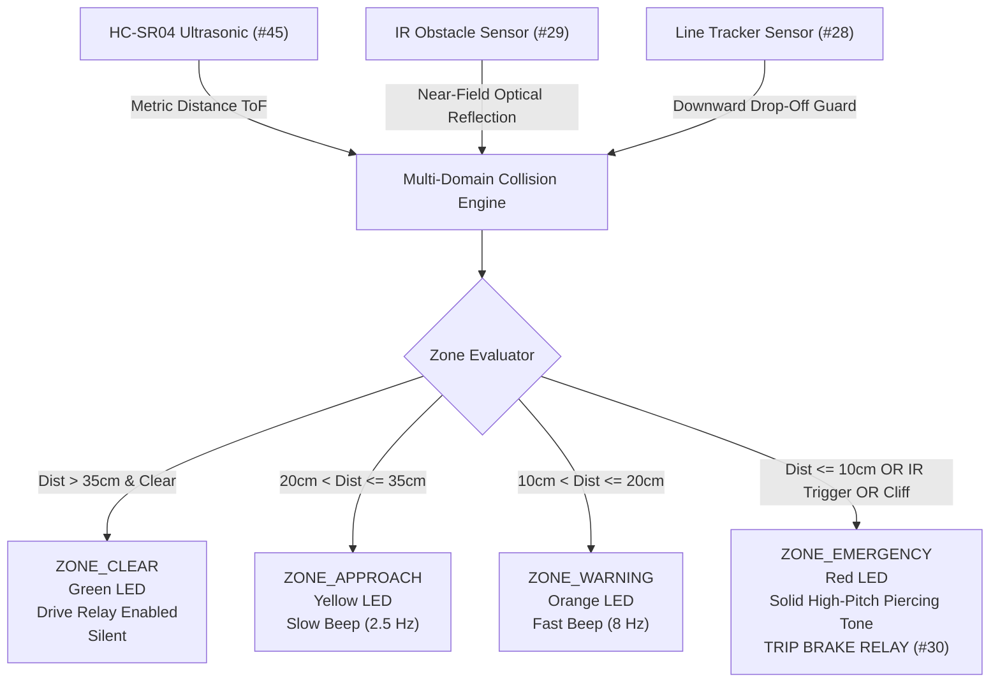

# Project 3: Autonomous Proximity Radar & Dual-Domain Anti-Collision System

## 1. Overview & Sensor Fusion Concept
Automated vehicles, robotic platforms, and industrial machinery require robust obstacle detection that cannot be defeated by environment anomalies:
- **Acoustic Ultrasonic Sensors (HC-SR04)** excel at measuring distance to large surfaces from 10cm to 400cm, but fail on thin wires, sound-absorbing foam/curtains, or when objects strike at steep angled reflections.
- **Optical Infrared Sensors (Module #29)** respond within microseconds to obstacles directly in front of the vehicle (1cm to 10cm), catching sudden entries that fall inside the ultrasonic sensor's near-field blind spot.
- **Line Tracking Sensors (Module #28)** pointed downwards serve as ground reflection sensors, instantly detecting staircases, table edges, and cliff drop-offs.

---

## 2. Bill of Materials (from Hosyond 45-in-1 Kit)
| Component | Kit Module # | Function |
|---|---|---|
| Arduino Uno | Target Board | Central collision processing |
| Ultrasonic Module | Module #45 (HC-SR04) | Acoustic metric rangefinder |
| IR Obstacle Avoidance | Module #29 | Near-field high-speed optical reflex |
| Line Tracking Sensor | Module #28 | Downward cliff and drop-off monitor |
| RGB LED Module | Module #01 | 4-stage optical distance indicator |
| Passive Buzzer Module | Module #12 | Variable pitch automotive distance beeper |
| 5V Relay Module | Module #30 | Emergency braking / traction motor interlock |

---

## 3. Arduino Uno Wiring Table
| Module | Sensor Pin | Arduino Uno Pin | Description |
|---|---|---|---|
| **Ultrasonic (#45)** | Trig | **D12** | 10µs ultrasonic ping trigger |
| | Echo | **D11** | Echo pulse timing input |
| | VCC / GND | 5V / GND | Power supply |
| **IR Obstacle (#29)** | OUT | **D3** | Active LOW optical reflection detection |
| | VCC / GND | 5V / GND | Power supply |
| **Line Tracker (#28)** | OUT | **D2** | Active HIGH cliff drop-off detection |
| | VCC / GND | 5V / GND | Power supply |
| **RGB LED (#01)** | R (Red) | **D6 (PWM)** | Red color channel |
| | G (Green) | **D5 (PWM)** | Green color channel |
| | B (Blue) | **D9 (PWM)** | Blue color channel |
| | - (GND) | GND | Common Cathode ground |
| **Passive Buzzer (#12)** | S (Signal) | **D8** | Tone frequency output |
| | - (GND) | GND | Buzzer ground |
| **5V Relay (#30)** | IN | **D7** | Active LOW braking trigger |
| | VCC / GND | 5V / GND | Relay power |

---

## 4. Key Embedded Features
- **Exponential Moving Average Filter (EMA):** Smooths noisy ultrasonic distance measurements (`ALPHA = 0.4`), preventing false collision trips from stray acoustic noise.
- **Automotive Beeper Emulation:** As an obstacle closes in, the beeping interval dynamically decreases from 400ms down to 120ms, and locks into a solid 2.2 kHz alarm when collision is imminent.
- **Zero-Latency Emergency Brake:** The 5V relay trips instantly if either the optical near-field sensor or ground cliff sensor fires.
