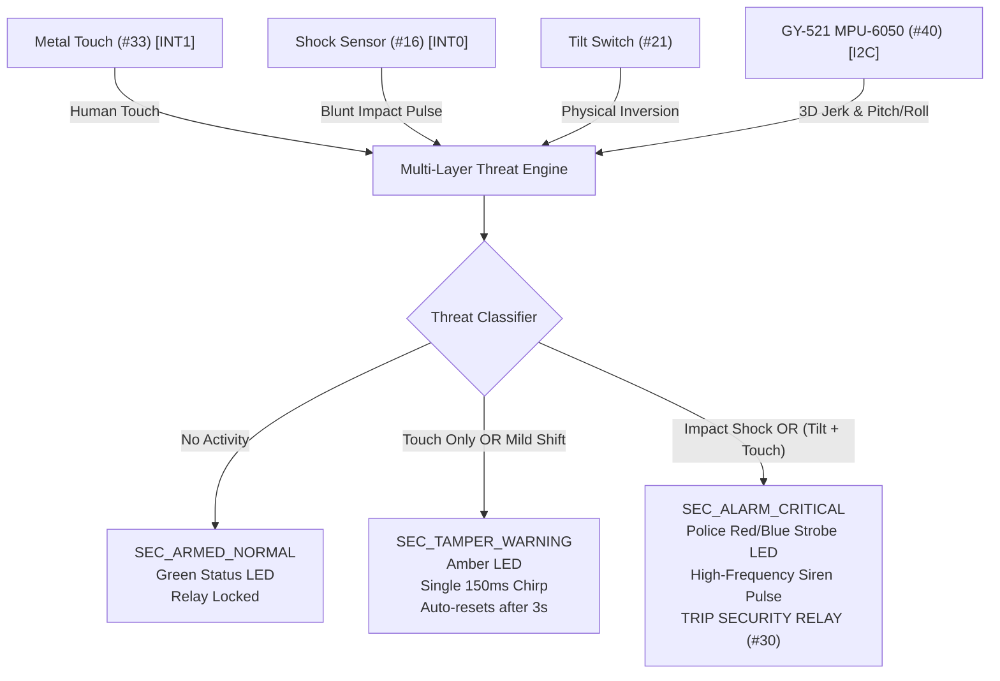

# Project 4: Multi-Layer Security Sentinel & Inertial Anti-Tamper System

## 1. Overview & Sensor Fusion Concept
Most commercial anti-theft and safe-deposit security devices fail because they either trigger falsely on minor ambient vibrations (footsteps, thunder, passing trucks) or are bypassed by slow, careful displacement.

This **Sensor Fusion Level 1 Project** constructs a 4-tier physical security bubble:
1. **Capacitive/Conductive Touch Layer:** The Metal Touch Sensor (#33) detects unauthorized hand or tool contact on the external enclosure before any mechanical force is applied.
2. **Inertial 6-DOF Vector Layer:** The MPU-6050 (GY-521 Module #40) continuously calculates 3D dynamic acceleration jerk $\Delta A = \sqrt{\Delta A_x^2 + \Delta A_y^2 + \Delta A_z^2}$ over I2C.
3. **Discrete Gravitational Tip Layer:** The Tilt Switch (#21) detects if the asset has been rolled or placed upside-down.
4. **Mechanical Shock Pulse Layer:** The Shock Sensor (#16) fires a microsecond hardware interrupt on physical blunt impacts, drilling, or hammer strikes.

---

## 2. Bill of Materials (from Hosyond 45-in-1 Kit)
| Component | Kit Module # | Function |
|---|---|---|
| Arduino Uno | Target Board | Threat matrix & interrupt processing |
| GY-521 (MPU-6050) | Module #40 | 6-DOF Accelerometer & Gyroscope (I2C) |
| Shock Sensor | Module #16 | Mechanical strike and impact impulse detection |
| Metal Touch Sensor | Module #33 | Perimeter human touch detection |
| Tilt Switch | Module #21 | Gravitational orientation switch |
| RGB LED Module | Module #01 | Multi-color security beacon |
| Active Buzzer Module | Module #11 | High-output alarm siren |
| 5V Relay Module | Module #30 | Electronic deadbolt lock or perimeter strobe trigger |

---

## 3. Arduino Uno Wiring Table
| Module | Sensor Pin | Arduino Uno Pin | Description |
|---|---|---|---|
| **GY-521 MPU-6050 (#40)** | SDA | **A4** | I2C Data line |
| | SCL | **A5** | I2C Clock line |
| | VCC / GND | 5V / GND | Power supply |
| **Shock Sensor (#16)** | S (DO) | **D2 (INT0)** | Microsecond hardware interrupt on impact |
| | - (GND) / + | GND / 5V | Power supply |
| **Metal Touch (#33)** | DO | **D3 (INT1)** | Hardware interrupt on physical contact |
| | + / - | 5V / GND | Power supply |
| **Tilt Switch (#21)** | S | **D4** | Digital tilt state (internal pullup) |
| | - | GND | Ground |
| **RGB LED (#01)** | R (Red) | **D9 (PWM)** | Red color channel |
| | G (Green) | **D10 (PWM)** | Green color channel |
| | B (Blue) | **D11 (PWM)** | Blue color channel |
| | - (GND) | GND | Common Cathode ground |
| **Active Buzzer (#11)** | S (Signal) | **D8** | Siren pulse audio |
| | - (GND) | GND | Buzzer ground |
| **5V Relay (#30)** | IN | **D7** | Active LOW deadbolt lock / strobe trigger |
| | VCC / GND | 5V / GND | Relay coil supply |

---

## 4. Key Embedded Features
- **Dual Hardware Interrupts (INT0 & INT1):** Guarantees zero missed impacts or touches, executing instantaneously even during serial print or timing operations.
- **Native Register-Level I2C Interface:** Talks directly to the MPU-6050 power and accelerometer registers (`0x3B` to `0x40`) without requiring third-party library installations!
- **Auto-Re-Arming:** Features a timed holding cycle (8 seconds) followed by automatic perimeter re-arming.
